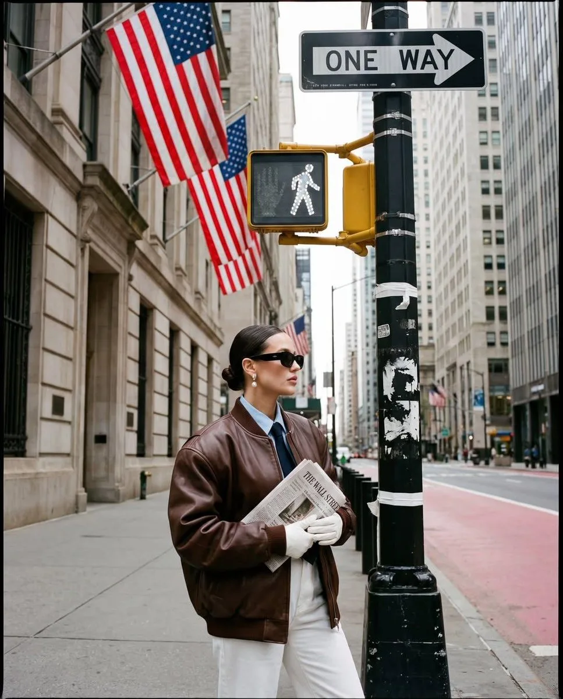

# simeon-sanai — by @Naiknelofar788

[← Back to Examples from X](../../EXAMPLES.md) · Category: Photography · Model: `Nano Banana`

<a href="https://x.com/Naiknelofar788/status/2021083866258342114"></a>

Original post: **[@Naiknelofar788 on X](https://x.com/Naiknelofar788/status/2021083866258342114)** · Creator: [simeon-sanai](https://x.com/Naiknelofar788)

## Prompt

```text
Ultra-realistic street fashion editorial photograph in New York City / Wall Street area, shot in vertical 3:4 (1152×1536). A stylish woman stands in the lower-right foreground on a wide concrete sidewalk at a street corner, posed in left-facing profile (body angled left, head slightly forward), calm confident expression. She wears large black rectangular sunglasses, pearl drop earrings, hair sleek center-part pulled into a low bun, subtle makeup with warm blush and muted lipstick. Outfit: oversized chocolate-brown leather bomber jacket with pronounced shoulders and glossy creases, layered over a light blue collared shirt and a dark necktie. Hands in front holding a folded newspaper: “THE WALL STREET” clearly visible across the top of the paper. She wears white gloves and high-waisted white pants (clean, structured).

Environment / Street Elements (Must match):

A tall black metal street pole dominates the right side foreground, wrapped with white tape bands and small worn stickers; at the top right there’s a black-and-white “ONE WAY” sign (arrow pointing right). Just left of the pole is a yellow/orange pedestrian traffic signal with the white walking figure illuminated. Above and behind, multiple large American flags hang from the stone building façade, the nearest flag filling the upper center-left area with visible red-and-white stripes and blue field. Background is a canyon of tall buildings: left side is an older light beige stone building with rectangular windows, vent-like panels, and dark trim at the base; right side shows modern tall buildings and a long street receding into the distance. On the roadway to the right is a pinkish-red lane (bus/bike lane feel) with textured sidewalk corner and a small red tactile paving patch near the pole base. Far background includes tiny pedestrians and cars along the street; everything is sharp enough to read the scene but remains secondary to the subject.

Composition / Perspective:

Wide-angle street perspective with strong vertical lines; the camera is at rough chest height aimed slightly upward so the signal, flags, and signs tower above the subject. Subject is framed from mid-thigh up, placed bottom-right, leaving large negative space of architecture and street signage above. Maintain exact spacing: pole near right edge, pedestrian signal centered above subject, flags hanging upper-left, street depth vanishing toward upper-right background.

Lighting / Color / Texture:

Overcast daylight with soft shadows, neutral highlights. Warm, slightly desaturated film look (beige stone tones, muted browns), subtle contrast, gentle lifted blacks. Add fine film grain and slight texture like a candid editorial street shot. Natural skin texture, realistic leather sheen and folds, realistic newspaper paper texture.

Camera / Lens / Settings (Emulation):

Full-frame look, 24–28mm wide lens, documentary/editorial street style, moderate depth of field (subject crisp, background slightly softer but still readable). Slight vintage/film-grade color science.

Hard Rules (No deviations):

Do not change the pose, outfit layers (brown leather jacket + blue shirt + tie), sunglasses shape, pearl earrings, bun hairstyle, white gloves, white pants, the “THE WALL STREET” newspaper text, the “ONE WAY” sign, the walking man icon, the American flags, or the exact NYC street-corner composition. No extra props, no extra people in foreground, no cropping changes, no stylization beyond realistic film/editorial grain.

Negative Prompt (Strict):

no illustration, no CGI look, no anime, no painterly texture, no extra typography overlays, no added logos, no changed signs, no different newspaper title, no different flag placement, no blur on main subject, no heavy HDR, no neon colors, no beauty-plastic skin, no distorted hands, no warped buildings, no random lens flares.
```

## Try it

Paste the prompt into **[vinano.ai](https://vinano.ai?utm_source=github&utm_medium=readme&utm_campaign=awesome-image-video-prompts-updating&utm_content=x-page-try)** to generate your own version.

> The image and prompt belong to [@Naiknelofar788](https://x.com/Naiknelofar788) and are shown here with credit for reference. Creators can ask for changes or removal by opening an issue.
