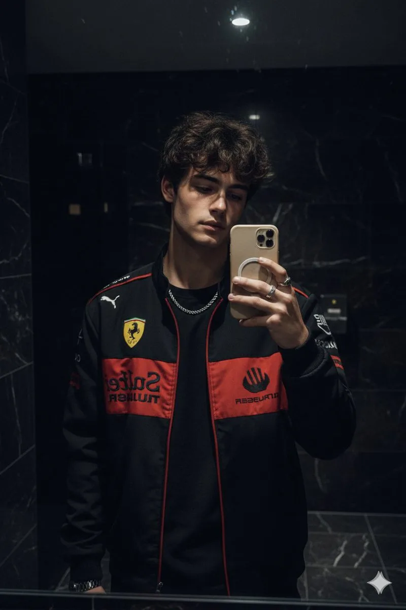

# Harboriis — by @harboriis

[← Back to Community Examples](../../EXAMPLES.md) · Category: Photography · Model: `Nano Banana`

<a href="https://x.com/harboriis/status/2011028969332805684"></a>

Source: **[@harboriis on X](https://x.com/harboriis/status/2011028969332805684)** · Creator: [Harboriis](https://x.com/harboriis)

## Prompt

```text
Create a hyper-realistic mirror selfie of me (use my face from the uploaded selfie) wearing the same black Ferrari racing jacket with red and yellow patches, black t-shirt underneath, silver rings, and chain.
I'm holding a phone with a beige
MagSafe case, posing in a dimly lit
modern bathroom with dark marble
walls. The lighting is soft and moody
capturing the same hairstyle, pose,
and reflection angle as in the
reference image - stylish, confident
cinematic vibe. Add a moody filter.
```

## Try it

Paste the prompt into **[vinano.ai](https://vinano.ai?utm_source=github&utm_medium=readme&utm_campaign=awesome-image-video-prompts-updating&utm_content=x-page-try)** to generate your own version.

> The image and prompt belong to @harboriis ([original post](https://x.com/harboriis/status/2011028969332805684)) and are shown here with credit for reference. Creators can ask for changes or removal by opening an issue.
