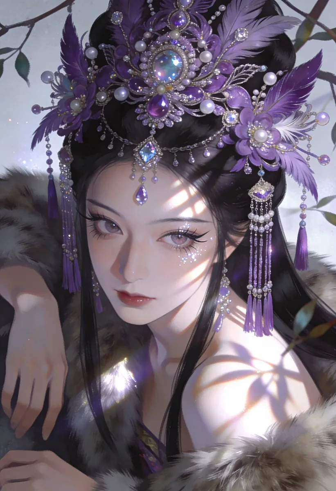

# underwood — by @underwoodxie96

[← Back to Examples from X](../../EXAMPLES.md) · Category: Illustration & 3D · Model: `Nano Banana`

<a href="https://x.com/underwoodxie96/status/2029149670061064470"></a>

Original post: **[@underwoodxie96 on X](https://x.com/underwoodxie96/status/2029149670061064470)** · Creator: [underwood](https://x.com/underwoodxie96)

## Prompt

```text
convert anime characters into realistic human portraits  Convert  character into a photorealistic live-action portrait / fashion editorial photograph, modern cinematic style, high-fashion grade, punchy but natural contrast, refined filmic color science, subtle halation and lens bloom, controlled highlights, soft roll-off, realistic skin pores and texture, lifelike hair strands, premium fabric/material rendering, studio-quality lighting with natural depth, preserve the original camera framing and composition exactly, no text, no logo.
```

## Try it

Paste the prompt into **[vinano.ai](https://vinano.ai?utm_source=github&utm_medium=readme&utm_campaign=awesome-image-video-prompts-updating&utm_content=x-page-try)** to generate your own version.

> The image and prompt belong to [@underwoodxie96](https://x.com/underwoodxie96) and are shown here with credit for reference. Creators can ask for changes or removal by opening an issue.
