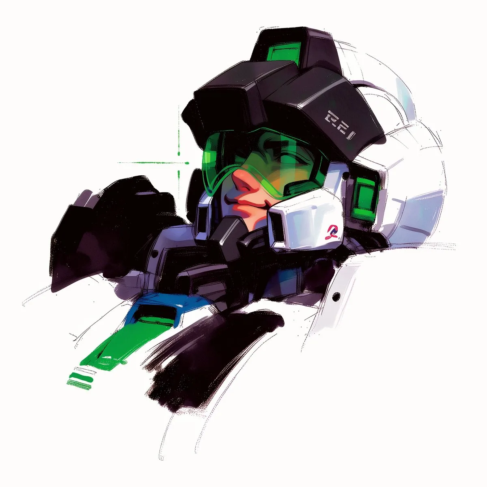

# INK — by @0xInk_

[← Back to Examples from X](../../EXAMPLES.md) · Category: Illustration & 3D · Model: `Nano Banana`

<a href="https://x.com/0xInk_/status/2043581294777713094"></a>

Original post: **[@0xInk_ on X](https://x.com/0xInk_/status/2043581294777713094)** · Creator: [INK](https://x.com/0xInk_)

## Prompt

```text
Convert to hyper-realistic 3D CGI collectible figurine render. Physically-based rendering, octane render quality. Preserve the original character design, pose, and outfit exactly. Transform all surfaces into real-world materials: fabric with visible weave and drape, metal with wear, scratches and oxidation, synthetic matte skin. Pure white studio background, clean seamless white backdrop, soft diffused lighting with subtle rim light. No cel shading, no toon rendering. High-end statue/collectible photography aesthetic. Ultra detailed, 8K. Fix and reconstruct all hands and fingers with correct anatomy: natural finger count, proper joint articulation, realistic proportions, no fused or melted digits. Remove all 2D artifacts, compression glitches, and Midjourney inconsistencies. Ensure full anatomical coherence across the entire figure: symmetrical features, clean silhouette, no floating elements, no distorted limbs, no duplicated body parts. Hyper-detailed hair simulation: individual strand rendering, realistic hair clumping, natural flow and gravity, visible scalp at roots, micro flyaways, SSS translucency on hair tips. Every surface pushed to maximum realism: pore-level skin texture, fabric fiber micro-detail, specular highlights on every material, depth in shadows
```

## Try it

Paste the prompt into **[vinano.ai](https://vinano.ai?utm_source=github&utm_medium=readme&utm_campaign=awesome-image-video-prompts-updating&utm_content=x-page-try)** to generate your own version.

> The image and prompt belong to [@0xInk_](https://x.com/0xInk_) and are shown here with credit for reference. Creators can ask for changes or removal by opening an issue.
