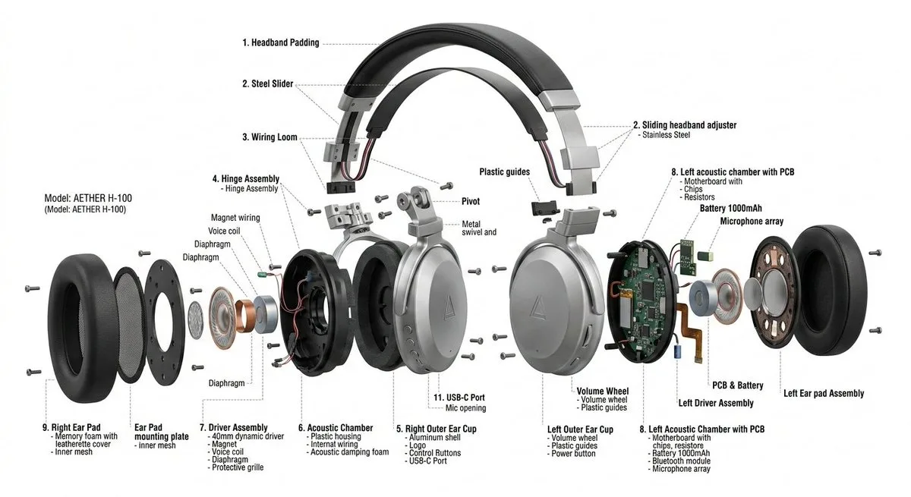

# 𝐌 — by @Strength04_X

[← Back to Community Examples](../../EXAMPLES.md) · Category: Product & Brand · Model: `Nano Banana`

<a href="https://x.com/Strength04_X/status/2028442638781984986"></a>

Source: **[@Strength04_X on X](https://x.com/Strength04_X/status/2028442638781984986)** · Creator: [𝐌](https://x.com/Strength04_X)

## Prompt

```text
product design, [object or vehicle with material accents], exploded view diagram, white background, three-dimensional, highly detailed internal components, studio lighting, product photography, best quality
```

## Try it

Paste the prompt into **[vinano.ai](https://vinano.ai?utm_source=github&utm_medium=readme&utm_campaign=awesome-image-video-prompts-updating&utm_content=x-page-try)** to generate your own version.

> The image and prompt belong to @Strength04_X ([original post](https://x.com/Strength04_X/status/2028442638781984986)) and are shown here with credit for reference. Creators can ask for changes or removal by opening an issue.
