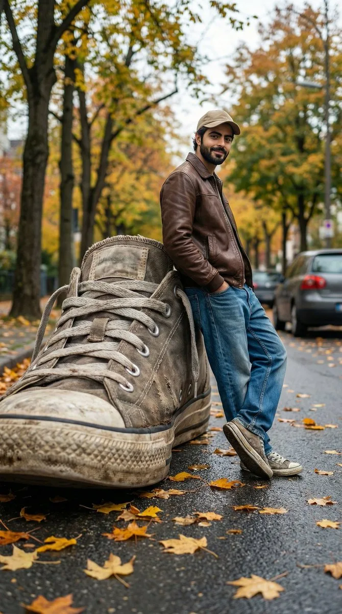

# Zar⭕on — by @Xaroonx

[← Back to Examples from X](../../EXAMPLES.md) · Category: Photography · Model: `Nano Banana`

<a href="https://x.com/Xaroonx/status/2011823507932659844"></a>

Original post: **[@Xaroonx on X](https://x.com/Xaroonx/status/2011823507932659844)** · Creator: [Zar⭕on](https://x.com/Xaroonx)

## Prompt

```text
A cinematic forced-perspective street photography scene where a giant worn-out sneaker appears enormous in the foreground, towering over a casually dressed young man leaning against it. The man wears a brown leather jacket, loose blue jeans, sneakers, and a beige cap, standing confidently with hands in pockets. Autumn atmosphere with yellow and orange leaves scattered on the road, talltrees with fall foliage in the background, parked car slightly blurred. Ultra-realistic textures on the shoe sole, visible dirt and fabric wear. Shot from a very low angle to exaggerate scale, shallow depth of field, natural daylight, soft cinematic color grading, realistic shadows, high detail, 8K resolution, professional photography, surreal yet believable forced perspective illusion.
```

## Try it

Paste the prompt into **[vinano.ai](https://vinano.ai?utm_source=github&utm_medium=readme&utm_campaign=awesome-image-video-prompts-updating&utm_content=x-page-try)** to generate your own version.

> The image and prompt belong to [@Xaroonx](https://x.com/Xaroonx) and are shown here with credit for reference. Creators can ask for changes or removal by opening an issue.
