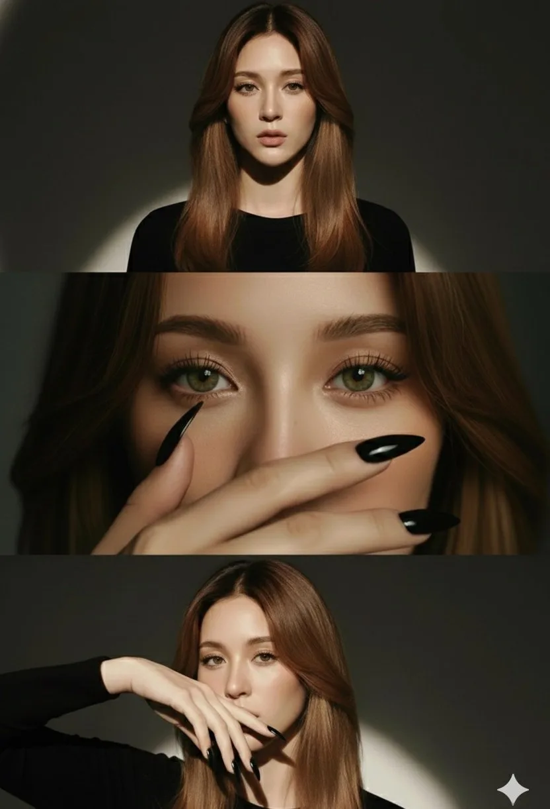

# Taaruk — by @Taaruk_

[← Back to Community Examples](../../EXAMPLES.md) · Category: Photography · Model: `Nano Banana`

<a href="https://x.com/Taaruk_/status/2009630448499167474"></a>

Source: **[@Taaruk_ on X](https://x.com/Taaruk_/status/2009630448499167474)** · Creator: [Taaruk](https://x.com/Taaruk_)

## Prompt

```text
{
  "Objective": "Create a high-fashion editorial studio portrait presented as a vertical triptych with cinematic luxury aesthetics",
  "PersonaDetails": {
    "Subject": {
      "Type": "Young woman",
      "Hair": "Long, sleek chestnut-brown hair",
      "Makeup": {
        "Style": "Natural, flawless skin",
        "Emphasis": "Eyes subtly enhanced for intensity"
      },
      "Wardrobe": "Minimalist black outfit",
      "OverallPresence": "Calm, confident, refined"
    }
  },
  "TriptychComposition": {
    "Layout": "Vertical triptych (three stacked frames)",
    "TopFrame": {
      "Framing": "Centered head-and-shoulders portrait",
      "Pose": "Straight-on, symmetrical composition",
      "Expression": "Calm, confident",
      "Focus": "Balanced facial proportions and elegance"
    },
    "MiddleFrame": {
      "Framing": "Extreme close-up of the eyes",
      "Focus": "Eyes in razor-sharp focus",
      "PoseDetail": "Hand partially covering the face",
      "Accessories": "Long, glossy black nails prominently visible",
      "Mood": "Intimate, intense, editorial"
    },
    "BottomFrame": {
      "Framing": "Three-quarter portrait",
      "Pose": "Hand posed elegantly near the lips",
      "Expression": "Subtle, poised, fashion-forward",
      "Focus": "Gesture, styling, and body language"
    }
  },
  "LightingAndAtmosphere": {
    "LightingStyle": "Dramatic directional studio lighting",
    "LightQuality": "Soft shadows with sculpted highlights",
    "Contrast": "Cinematic, high contrast",
    "Background": "Neutral dark studio backdrop"
  },
  "ArtDirection": {
    "Style": "Luxury beauty campaign",
    "Aesthetic": "Vogue-style high-fashion editorial",
    "SkinRendering": "Flawless yet natural skin texture",
    "DetailLevel": "Ultra-detailed with refined realism"
  },
  "PhotographyStyle": {
    "Genre": "High-fashion editorial studio photography",
    "CompositionFeel": "Clean, bold, graphic",
    "ImageQuality": "High resolution, premium commercial finish"
  },
  "Mood": {
    "Tone": "Elegant, powerful, modern",
    "Energy": "Confident, controlled, luxurious"
  },
  "NegativePrompt": [
    "casual fashion",
    "street photography",
    "overly dramatic makeup",
    "soft focus eyes",
    "busy background",
    "oversaturated colors",
    "low contrast",
    "plastic skin"
  ],
  "ResponseFormat": {
    "Type": "Single composite image",
    "Layout": "Vertical triptych",
    "Orientation": "Portrait",
    "AspectRatio": "1:2"
  }
}
```

## Try it

Paste the prompt into **[vinano.ai](https://vinano.ai?utm_source=github&utm_medium=readme&utm_campaign=awesome-image-video-prompts-updating&utm_content=x-page-try)** to generate your own version.

> The image and prompt belong to @Taaruk_ ([original post](https://x.com/Taaruk_/status/2009630448499167474)) and are shown here with credit for reference. Creators can ask for changes or removal by opening an issue.
