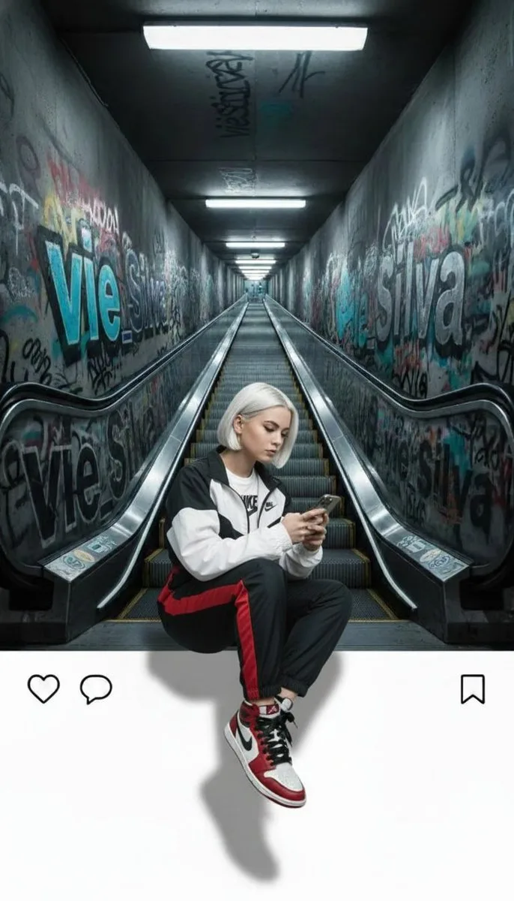

# Aijaz — by @iamsofiaijaz

[← Back to Examples from X](../../EXAMPLES.md) · Category: Illustration & 3D · Model: `Nano Banana`

<a href="https://x.com/iamsofiaijaz/status/2011387267282276607"></a>

Original post: **[@iamsofiaijaz on X](https://x.com/iamsofiaijaz/status/2011387267282276607)** · Creator: [Aijaz](https://x.com/iamsofiaijaz)

## Prompt

```text
A high-definition, realistic 3D social media profile picture style. The image features the young English girl with sleek, straight white hair and a clear, detailed face. She is wearing a coordinated Nike brand outfit consisting of a premium black and red Nike tracksuit with a visible swoosh logo. On her feet are classic red, white, and black Nike Air Jordan sneakers. She is sitting on the edge of a white Instagram-style frame, with her legs and one sneaker 'popping out' of the bottom of the frame for a 3D effect. The background inside the frame shows her sitting on a long, perspective-heavy escalator in a dark, gritty subway tunnel filled with colorful graffiti. She is looking down at a smartphone in her hands. The lighting is cinematic, highlighting her white hair and the textures of the Nike fabric."
```

## Try it

Paste the prompt into **[vinano.ai](https://vinano.ai?utm_source=github&utm_medium=readme&utm_campaign=awesome-image-video-prompts-updating&utm_content=x-page-try)** to generate your own version.

> The image and prompt belong to [@iamsofiaijaz](https://x.com/iamsofiaijaz) and are shown here with credit for reference. Creators can ask for changes or removal by opening an issue.
