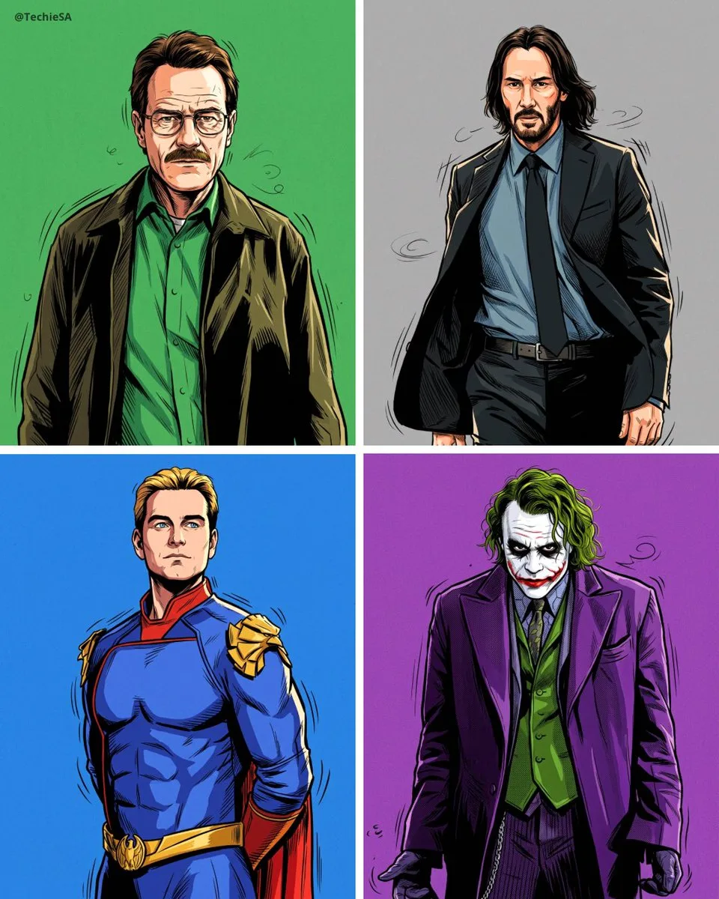

# TechieSA — by @TechieBySA

[← Back to Examples from X](../../EXAMPLES.md) · Category: Illustration & 3D · Model: `Nano Banana`

<a href="https://x.com/TechieBySA/status/2028810677301788892"></a>

Original post: **[@TechieBySA on X](https://x.com/TechieBySA/status/2028810677301788892)** · Creator: [TechieSA](https://x.com/TechieBySA)

## Prompt

```text
Create a high-contrast digital comic-style illustration of [PERSON] based strictly on the provided reference image.
STRICT IDENTITY LOCK:
∙Preserve exact facial bone structure
∙Preserve exact skin tone
∙Preserve beard density and shape (if applicable)
∙Preserve tattoo placement and design (if visible)
∙Do NOT stylize, redesign, beautify, exaggerate, or cartoonify the face
∙The person must remain clearly recognizable
POSE:
Upper-body focused composition.
Keep the pose exactly the same as in the reference image.
STYLE:
∙Bold black ink outlines
∙Strong dynamic line variation
∙Clean comic-book contouring
∙Cross-hatching shading technique (visible hand-drawn hatch lines)
∙No soft airbrush shading
∙No smooth gradient blending
∙Hard shadow planes
∙Graphic novel illustration style
COLOR SYSTEM:
∙Flat saturated color blocks
∙High contrast between light and shadow
∙No photorealistic rendering
∙No painterly brush strokes
∙Slight warm skin highlights
∙Clothing colors must match the reference image exactly
TEXTURE:
∙Subtle paper grain texture
∙Ink illustration feel
∙Hand-drawn motion lines around arms and shoulders
BACKGROUND:
∙Solid flat background color complementary to the subject’s outfit or chosen palette
∙No environment
∙No depth blur
∙Minimalistic
∙Slight grain texture allowed
ENERGY DETAILS:
∙Hand-drawn motion lines indicating movement
∙Subtle sketch swirls around the subject
∙Dynamic comic vibration lines
LIGHTING:
∙Strong directional light from upper side
∙Hard comic-style shadow edges
∙Deep contrast under arms and jawline
∙Defined muscle contour shadows
COMPOSITION:
∙Vertical 4:5 ratio (Instagram optimized)
∙Subject centered
∙Upper torso dominant
∙Clean negative space around figure
QUALITY:
∙High resolution
∙Clean line clarity
∙Sharp edges
∙No blur
∙No AI artifact distortion
```

## Try it

Paste the prompt into **[vinano.ai](https://vinano.ai?utm_source=github&utm_medium=readme&utm_campaign=awesome-image-video-prompts-updating&utm_content=x-page-try)** to generate your own version.

> The image and prompt belong to [@TechieBySA](https://x.com/TechieBySA) and are shown here with credit for reference. Creators can ask for changes or removal by opening an issue.
