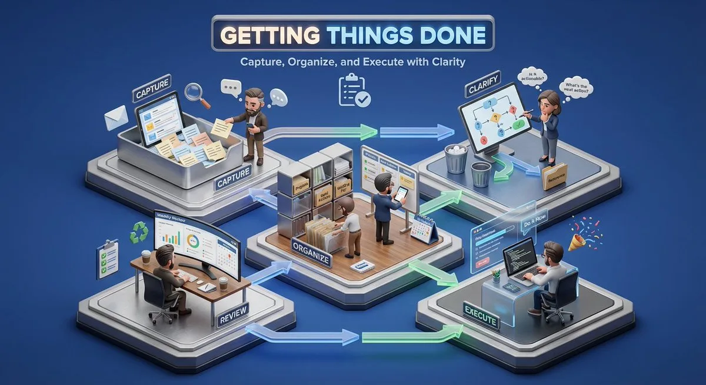

# Aleena Amir — by @aleenaamiir

[← Back to Community Examples](../../EXAMPLES.md) · Category: Illustration & 3D · Model: `Nano Banana`

<a href="https://x.com/aleenaamiir/status/2022522374483235110"></a>

Source: **[@aleenaamiir on X](https://x.com/aleenaamiir/status/2022522374483235110)** · Creator: [Aleena Amir](https://x.com/aleenaamiir)

## Prompt

```text
Create a 3D isometric miniature diorama showcasing the productivity system [SYSTEM NAME]. Angle remains between 35–45°. Materials feel modern and structured with realistic PBR textures.

Lighting is soft but focused. The raised base is divided into functional zones such as planning, execution, tracking, and review. Use connecting paths or arrows to show workflow.

Tiny stylized professionals interact with desks, boards, or devices. With heavy facial details.
Background remains solid [BACKGROUND COLOR].

Top center shows [SYSTEM NAME] in bold. Below it add a short benefit-focused subtitle. Place a minimal productivity icon underneath. Text automatically adapts.”
```

## Try it

Paste the prompt into **[vinano.ai](https://vinano.ai?utm_source=github&utm_medium=readme&utm_campaign=awesome-image-video-prompts-updating&utm_content=x-page-try)** to generate your own version.

> The image and prompt belong to @aleenaamiir ([original post](https://x.com/aleenaamiir/status/2022522374483235110)) and are shown here with credit for reference. Creators can ask for changes or removal by opening an issue.
