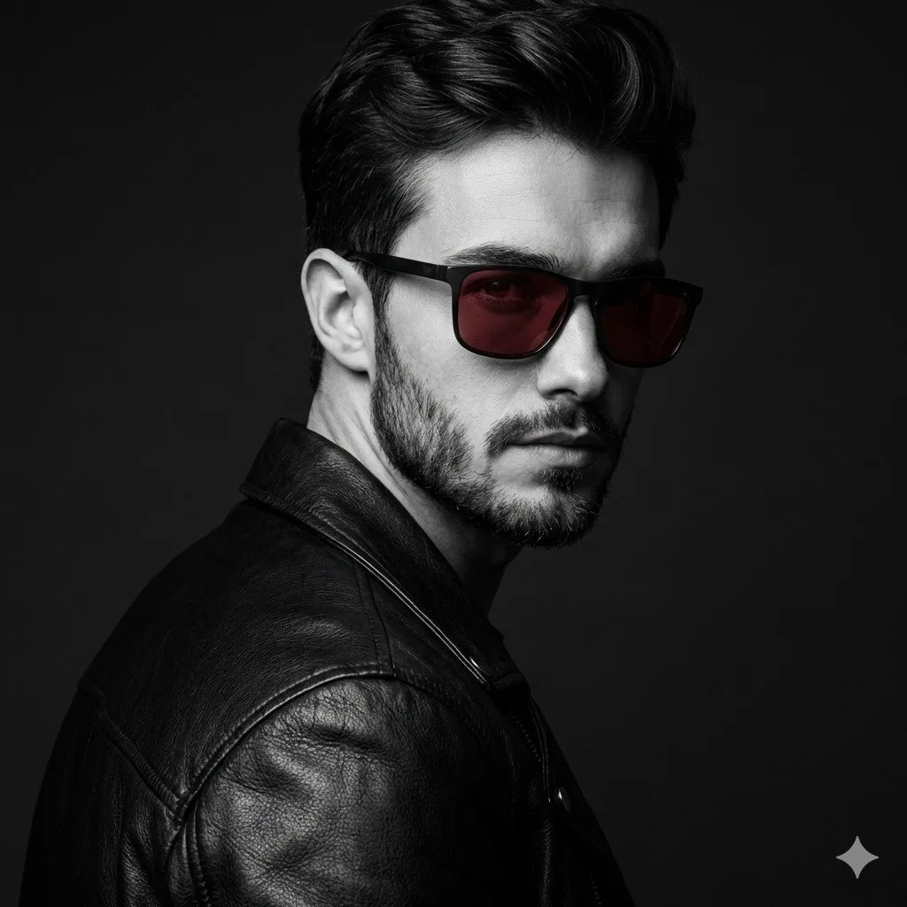

# K — by @ChillaiKalan__

[← Back to Community Examples](../../EXAMPLES.md) · Category: Photography · Model: `Nano Banana`

<a href="https://x.com/ChillaiKalan__/status/2010202953123295307"></a>

Source: **[@ChillaiKalan__ on X](https://x.com/ChillaiKalan__/status/2010202953123295307)** · Creator: [K](https://x.com/ChillaiKalan__)

## Prompt

```text
Use 100% of the uploaded reference image for the exact face, identity, and facial structure — do not alter facial features. A high-contrast black-and-white fashion portrait of a handsome young man in his late 20s with black hair and a well-groomed black beard, looking over his shoulder toward the camera. He wears a stylish black leather jacket with visible grain texture and modern rectangular sunglasses with deep red-tinted lenses.
```

## Try it

Paste the prompt into **[vinano.ai](https://vinano.ai?utm_source=github&utm_medium=readme&utm_campaign=awesome-image-video-prompts-updating&utm_content=x-page-try)** to generate your own version.

> The image and prompt belong to @ChillaiKalan__ ([original post](https://x.com/ChillaiKalan__/status/2010202953123295307)) and are shown here with credit for reference. Creators can ask for changes or removal by opening an issue.
