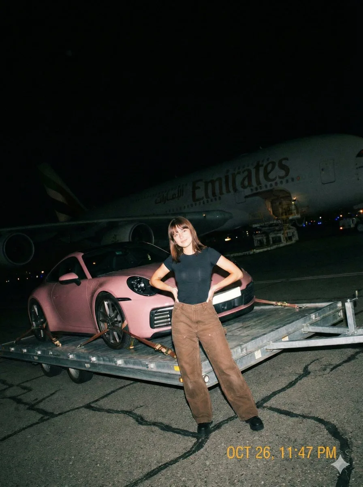

# 𝐌 — by @Strength04_X

[← Back to Community Examples](../../EXAMPLES.md) · Category: Photography · Model: `Nano Banana`

<a href="https://x.com/Strength04_X/status/2015428737005912073"></a>

Source: **[@Strength04_X on X](https://x.com/Strength04_X/status/2015428737005912073)** · Creator: [𝐌](https://x.com/Strength04_X)

## Prompt

```text
A gritty, handheld iPhone photo taken at night on an airport tarmac with harsh direct on-camera flash. Imperfect, slightly crooked framing, like a spon-taneous snap. In the foreground, the woman stands beside a pink Porsche 911 on a flatbed trailer, mid-coy gesture, body angled three-quarters, one hand near her face. She wears wide Carhartt-style jeans and a fitted top, straight bangs framing her face flirty, casual, unplanned. In the background, a huge Emirates Airbus A380 looms in darkness, barely visible beyond flash falloff, cargo door open. Blown highlights on her, hard shadows on concrete, the plane mostly swallowed by night.
```

## Try it

Paste the prompt into **[vinano.ai](https://vinano.ai?utm_source=github&utm_medium=readme&utm_campaign=awesome-image-video-prompts-updating&utm_content=x-page-try)** to generate your own version.

> The image and prompt belong to @Strength04_X ([original post](https://x.com/Strength04_X/status/2015428737005912073)) and are shown here with credit for reference. Creators can ask for changes or removal by opening an issue.
