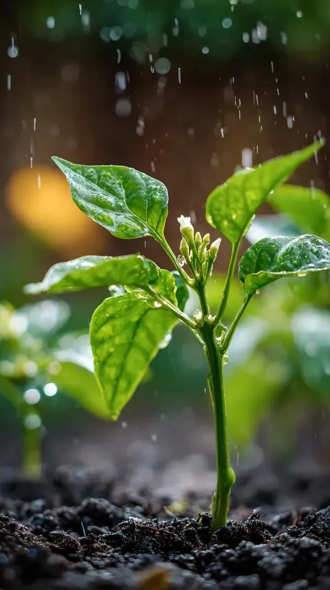

# 𝐌 — by @Strength04_X

[← Back to Community Examples](../../EXAMPLES.md) · Category: Photography · Model: `Nano Banana`

<a href="https://x.com/Strength04_X/status/2025073987521507338"></a>

Source: **[@Strength04_X on X](https://x.com/Strength04_X/status/2025073987521507338)** · Creator: [𝐌](https://x.com/Strength04_X)

## Prompt

```text
A small chili plant with glossy green leaves and one tiny white flower bud forming, emerging from dark damp soil. Light rain falling gently, droplets visible mid-air. Ground-level camera angle, intense macro detail on leaf veins and wet soil granules. Soft daylight with warm evening tones, natural reflections on wet surfaces. Background garden softly blurred with circular bokeh highlights. Backlit leaves with subtle translucency. Shot on 100mm macro lens, shallow depth of field, f/2.8
```

## Try it

Paste the prompt into **[vinano.ai](https://vinano.ai?utm_source=github&utm_medium=readme&utm_campaign=awesome-image-video-prompts-updating&utm_content=x-page-try)** to generate your own version.

> The image and prompt belong to @Strength04_X ([original post](https://x.com/Strength04_X/status/2025073987521507338)) and are shown here with credit for reference. Creators can ask for changes or removal by opening an issue.
