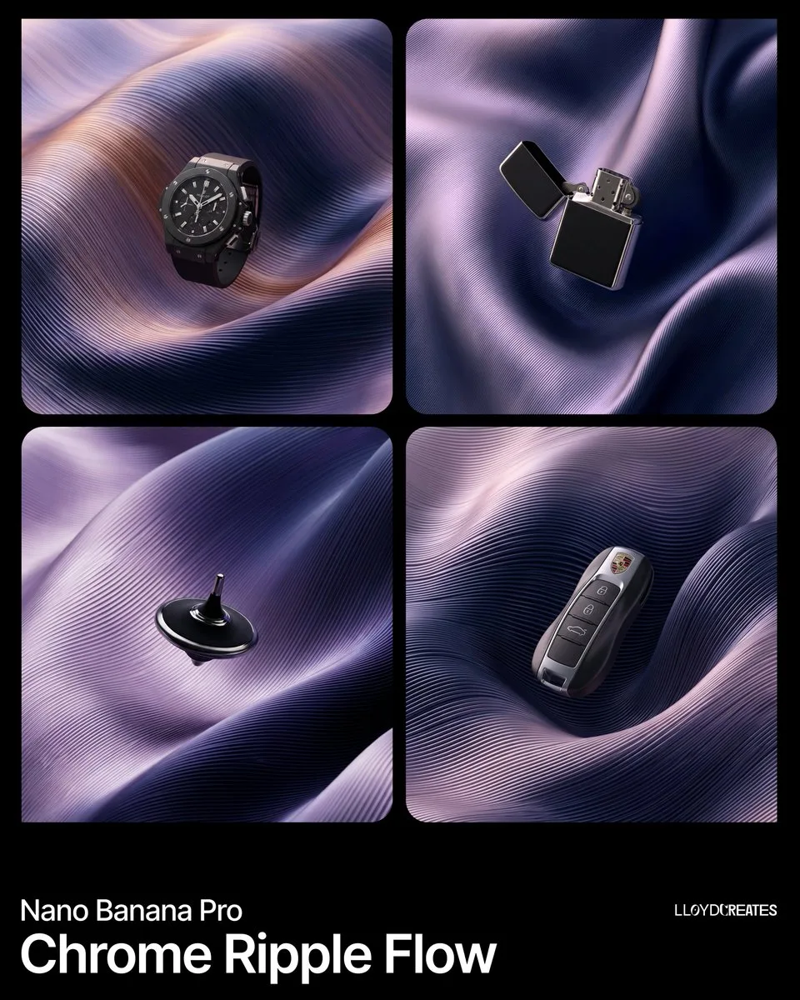

# Lloyd Creates — by @lloydcreates

[← Back to Examples from X](../../EXAMPLES.md) · Category: Product & Brand · Model: `Nano Banana`

<a href="https://x.com/lloydcreates/status/2021984673216209395"></a>

Original post: **[@lloydcreates on X](https://x.com/lloydcreates/status/2021984673216209395)** · Creator: [Lloyd Creates](https://x.com/lloydcreates)

## Prompt

```text
{
  "image_generation_request": {
    "subject": "[PRODUCT]",
    "product_finish": {
      "primary": "matte black with subtle light absorption",
      "secondary": "polished metallic silver with mirror-like reflections",
      "treatment": "duotone — matte black body with metallic silver accents, trim, edges, or panel insets"
    },
    "composition": {
      "placement": "dead center, full view, floating suspended within the folded surface environment",
      "scale": "product occupies roughly 30-40% of the frame",
      "constraints": [
        "product must be entirely visible with no cropping",
        "no pedestals, stands, platforms, or ground planes",
        "the surface folds frame the product but never obscure more than 10% of it",
        "product is the sharpest element in the scene"
      ]
    },
    "background_environment": {
      "description": "A single continuous undulating surface that fills the entire frame, folding over and around itself in large voluminous waves — like a massive sheet of pleated metallic silk or a single machined metal panel that has been softly twisted and draped. This is NOT multiple separate ribbons or strands. It is ONE connected surface.",
      "base_color": "[INSERT DEEP BACKGROUND COLOR visible in crevices — e.g. pure black, midnight navy]",
      "surface_color_1": "[INSERT GRADIENT COLOR A — e.g. soft lavender, warm copper, pearl rose]",
      "surface_color_2": "[INSERT GRADIENT COLOR B — e.g. deep indigo, cobalt blue, violet]",
      "color_behavior": "The two colors blend in a smooth continuous gradient across the single surface, shifting based on the surface's curvature and light angle. Where the surface faces the light it shows color_1, where it curves away it transitions to color_2. The transition is seamless with no hard edges or stripes.",
      "surface_texture": {
        "type": "fine parallel ribs embossed into the surface — like the grooves on a vinyl record or finely pleated accordion fabric",
        "rib_description": "extremely fine, uniform, tightly spaced parallel lines that follow the flow direction of the surface. The ribs are a TEXTURE on the surface, not separate objects. They create a subtle corrugated micro-relief that catches light along each tiny ridge.",
        "rib_density": "very high — approximately 50-100 visible lines per inch of surface, creating a dense linear grain",
        "rib_depth": "shallow — the ribs are subtle surface detail, not deep cuts. They create gentle highlight-shadow alternation across the surface"
      },
      "surface_form": {
        "fold_style": "large, smooth, voluminous folds like draped heavy silk — broad sweeping curves with gentle twists",
        "fold_count": "3-5 major folds visible, each one wide and generous, NOT many small tangled ribbons",
        "fold_behavior": "folds overlap softly, tucking under and over each other with smooth transitions. Where folds meet they create deep soft shadow crevices",
        "tension": "the surface appears smooth and taut across each fold, with no wrinkles or crumpling — like stretched satin over a curved form",
        "edges": "no visible edges — the surface appears to extend beyond the frame in all directions, as if we are seeing a close-up section of an infinite draped form"
      },
      "material": {
        "finish": "satin metallic — a soft brushed-metal luminosity between matte and mirror. The surface has a pearlescent quality where colors shift with viewing angle",
        "light_interaction": "soft specular highlights along the crest of each rib, gentle shadows in each rib valley, creating an overall shimmering linear texture across the broad folds"
      }
    },
    "lighting": {
      "type": "soft, diffused, directional — as if a large softbox is illuminating from upper-left, creating a warm-to-cool gradient across the scene",
      "shadow_behavior": "deep soft shadows in fold crevices, gradual falloff — no harsh edges",
      "highlight_behavior": "broad soft highlights across fold peaks, with fine linear shimmer from the rib texture",
      "restrictions": "no visible light sources, no lens flare, no reflections of studio equipment"
    },
    "style": {
      "aesthetic": "parametric design art, computational sculpture, abstract luxury",
      "mood": "luxurious, smooth, tactile, premium product showcase",
      "critical_note": "The background must look like a SINGLE continuous folded metallic surface with fine ribbed texture — NOT like multiple separate ribbons, cables, wires, or strands bundled together. Think of one sheet of finely pleated metal that has been elegantly draped and folded."
    },
    "technical_specs": {
      "quality": "8k resolution, extreme surface texture detail, tack-sharp product focus",
      "render_style": "photorealistic 3D render, Octane or Redshift quality",
      "aspect_ratio": "1:1 square",
      "exclusions": "text, watermarks, logos on background, extra props, lens flare, studio equipment, flat surfaces, any ground plane, separate ribbons, wire bundles, rope-like forms"
    }
  }
}
```

## Try it

Paste the prompt into **[vinano.ai](https://vinano.ai?utm_source=github&utm_medium=readme&utm_campaign=awesome-image-video-prompts-updating&utm_content=x-page-try)** to generate your own version.

> The image and prompt belong to [@lloydcreates](https://x.com/lloydcreates) and are shown here with credit for reference. Creators can ask for changes or removal by opening an issue.
