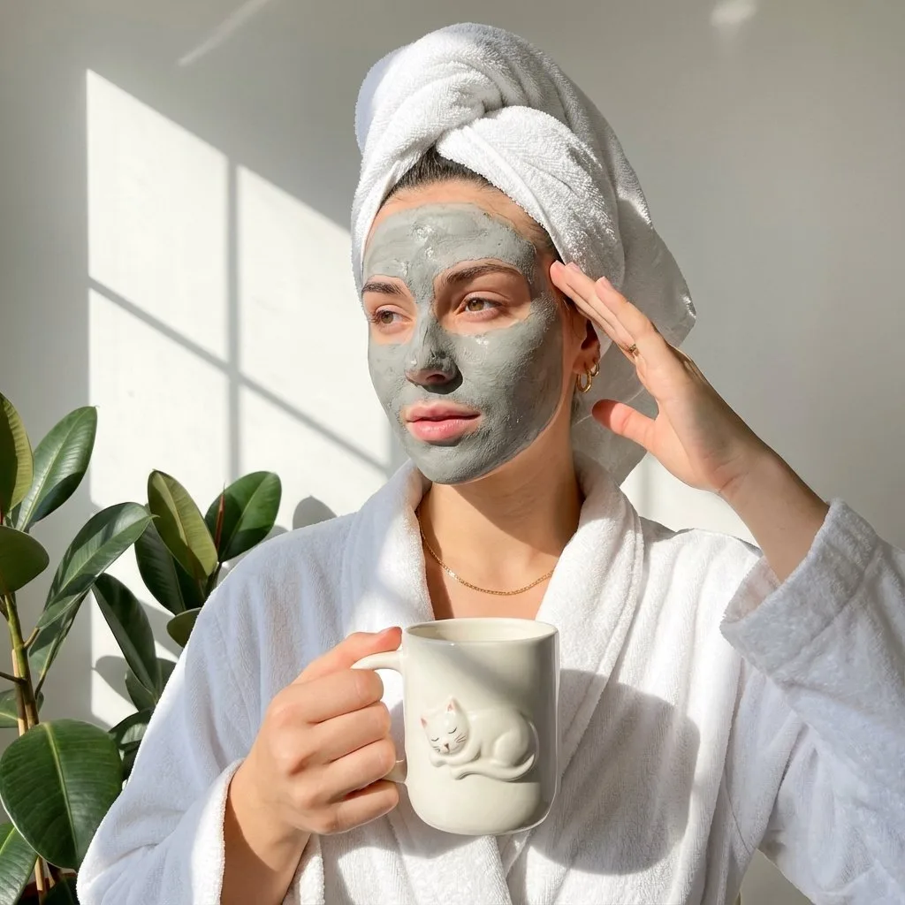

# 𝗦𝗮𝗻𝗶𝗮 — by @saniaspeaks_

[← Back to Examples from X](../../EXAMPLES.md) · Category: Photography · Model: `Nano Banana`

<a href="https://x.com/saniaspeaks_/status/2015284406307692759"></a>

Original post: **[@saniaspeaks_ on X](https://x.com/saniaspeaks_/status/2015284406307692759)** · Creator: [𝗦𝗮𝗻𝗶𝗮](https://x.com/saniaspeaks_)

## Prompt

```text
{
  "image_generation": {
    "subject": {
      "description": "young woman enjoying a calm self-care moment",
      "expression": "relaxed, thoughtful, peaceful",
      "face": "natural facial features with a gray clay face mask applied evenly",
      "skin": "natural skin tone, soft texture"
    },
    "hair": {
      "style": "hair wrapped in a white towel turban",
      "appearance": "clean, spa-style look"
    },
    "outfit": {
      "clothing": "white bathrobe",
      "style": "minimal, cozy, spa aesthetic",
      "accessories": "small gold hoop earrings, delicate gold necklace"
    },
    "pose": {
      "hands": "one hand holding a ceramic mug, other hand lightly touching the side of the head",
      "posture": "upright, relaxed stance"
    },
    "props": {
      "mug": "white ceramic mug with a cute cat design",
      "theme": "morning relaxation, wellness routine"
    },
    "environment": {
      "setting": "bright indoor space near a window",
      "background": "soft white wall with natural window light and leafy green houseplant",
      "mood": "calm, fresh, minimal"
    },
    "lighting": {
      "type": "natural sunlight",
      "direction": "side-lit through a window",
      "effect": "soft shadows, warm highlights"
    },
    "camera": {
      "style": "lifestyle photography",
      "angle": "medium close-up",
      "focus": "sharp focus on subject, softly blurred background",
      "quality": "high-resolution, photorealistic"
    },
    "aesthetic": {
      "theme": "self-care, wellness, morning routine",
      "color_palette": "soft whites, neutral tones, natural greens",
      "vibe": "clean, peaceful, luxurious yet minimal"
    }
  }
}
```

## Try it

Paste the prompt into **[vinano.ai](https://vinano.ai?utm_source=github&utm_medium=readme&utm_campaign=awesome-image-video-prompts-updating&utm_content=x-page-try)** to generate your own version.

> The image and prompt belong to [@saniaspeaks_](https://x.com/saniaspeaks_) and are shown here with credit for reference. Creators can ask for changes or removal by opening an issue.
