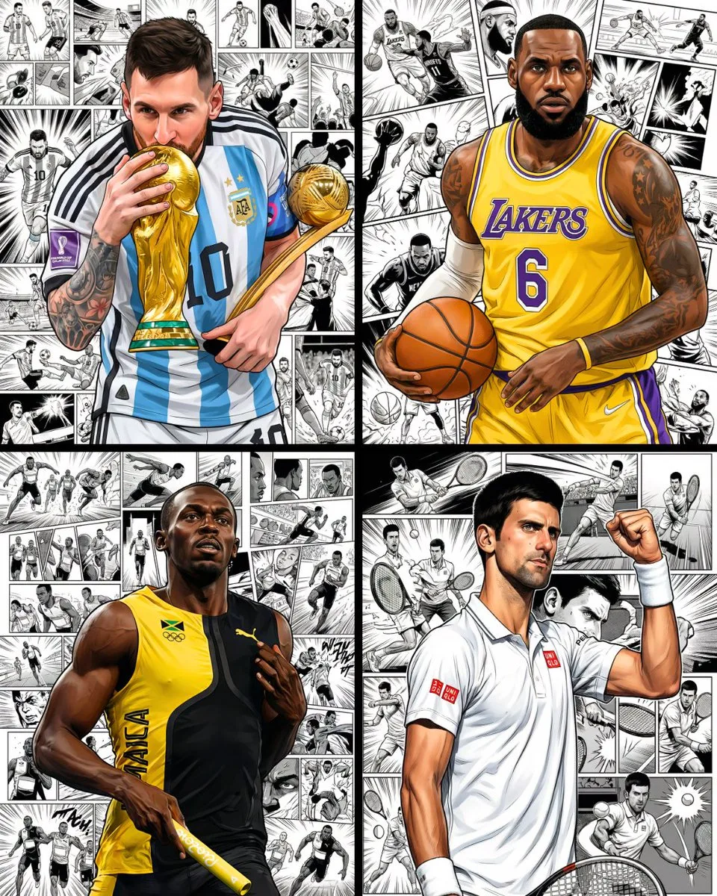

# TechieSA — by @TechieBySA

[← Back to Community Examples](../../EXAMPLES.md) · Category: Illustration & 3D · Model: `Nano Banana`

<a href="https://x.com/TechieBySA/status/2025580480175710454"></a>

Source: **[@TechieBySA on X](https://x.com/TechieBySA/status/2025580480175710454)** · Creator: [TechieSA](https://x.com/TechieBySA)

## Prompt

```text
Create an image in 4:5 ratio, with hyper-realistic aesthetics applied to a premium cartoon/cinematographic manga style, combining extreme realism with high-impact illustrated visual language.

The face must be identical to that of the photo sent in 103%, maintaining absolute tidelity the original tactical identity: bone structure, skull shape, proportions, intense expression, eyebrows, eyes, nose, mouth, jaw, mustache, hair and capillary volume.

No aesthetic change, identity change, artificial smoothing or stylization that mischaracterizes the face.

Male character reference pose. Stroke style inspired by high-level realistic cartoon, with well-defined volumes, deep shadows and clean finish.

costume: referenced image, with realistic fabric texture, natural folds and precise lighting.

Background composed of black and white comic panels, organized in multiple narrative frames, creating depth, visual context and sensation of an expanded universe. The panels should look like action scenes and graphic narrative, with varied perspective and dynamic composition.

Professional cinematic lighting, with soft front main light and dramatic contrast, precise face enhancements, controlled shadows, subtle depth of field, extreme sharpness, visible microdetails, premium rendering finish.

Maximum quality, high-budget editorial illustration appearance, full focus on the face, strong visual impact, Realism 333%, no readable texts, no watermarks, no distortions, no artifacts.
```

## Try it

Paste the prompt into **[vinano.ai](https://vinano.ai?utm_source=github&utm_medium=readme&utm_campaign=awesome-image-video-prompts-updating&utm_content=x-page-try)** to generate your own version.

> The image and prompt belong to @TechieBySA ([original post](https://x.com/TechieBySA/status/2025580480175710454)) and are shown here with credit for reference. Creators can ask for changes or removal by opening an issue.
