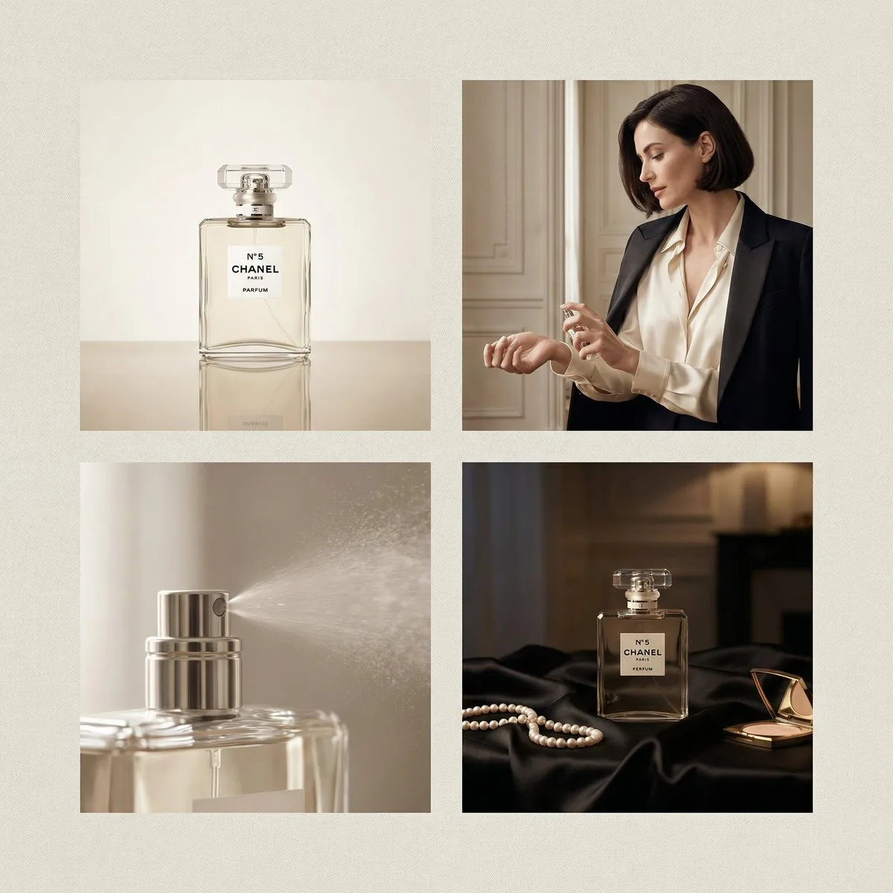

# Keskin — by @craftian_keskin

[← Back to Community Examples](../../EXAMPLES.md) · Category: Product & Brand · Model: `Nano Banana`

<a href="https://x.com/craftian_keskin/status/2016146144590541290"></a>

Source: **[@craftian_keskin on X](https://x.com/craftian_keskin/status/2016146144590541290)** · Creator: [Keskin](https://x.com/craftian_keskin)

## Prompt

```text
2×2 grid luxury perfume advertisement for Chanel perfume, four distinct yet cohesive high-end commercial images, elegant Parisian aesthetic, timeless fashion branding.

Panel 1 – Hero Product Elegance

Minimalist studio shot of a Chanel perfume bottle centered on a reflective surface. Soft, diffused lighting highlights the glass clarity, sharp edges, and iconic label. Neutral background in beige, ivory, or soft black. Luxurious, calm, iconic composition.

Panel 2 – Parisian Lifestyle Mood

Elegant adult woman in a classic Parisian interior vintage molding. She gently applies Chanel perfume to her neck or wrist. Natural light, effortless beauty, refined posture. Editorial fashion photography style, understated luxury.

Panel 3 – Sensory Detail Close-Up

Macro close-up of the Chanel perfume bottle with fine mist dispersing into the air. Light catches the spray particles. Soft shadows, shallow depth of field. Emphasis on texture, fragrance atmosphere, and sensory refinement.

Panel 4 – Cinematic Night Glamour

Moody, cinematic scene with the Chanel perfume bottle placed on a dark surface beside silk fabric or pearls. Low-key lighting, warm highlights, deep shadows. Evokes mystery, confidence, and timeless femininity.

All four images are visually unified through refined color grading, restrained contrast, and classic Chanel luxury cues.

Visual Style

Luxury fashion advertising
Editorial, timeless, refined
Soft contrast
Muted neutral palette
High realism
Clean composition
Parisian elegance

Camera & Lighting

Professional studio and editorial photography
50–85mm lens look
Shallow depth of field
Soft diffused lighting
Controlled highlights and shadows
Perfect label clarity

Mood Keywords

Elegant
Iconic
Sophisticated
Timeless
Feminine
Confident
Luxury

Negative Prompt

Cheap packaging, distorted logo, misspelled branding, harsh lighting, oversaturation, cluttered background, CGI look, cartoon style, watermark, text overlays, knockoff perfume bottles

Aspect Ratio

Overall canvas: 1:1
Grid: 2×2 equal squares
Optimized for luxury brand advertising and social campaigns
```

## Try it

Paste the prompt into **[vinano.ai](https://vinano.ai?utm_source=github&utm_medium=readme&utm_campaign=awesome-image-video-prompts-updating&utm_content=x-page-try)** to generate your own version.

> The image and prompt belong to @craftian_keskin ([original post](https://x.com/craftian_keskin/status/2016146144590541290)) and are shown here with credit for reference. Creators can ask for changes or removal by opening an issue.
