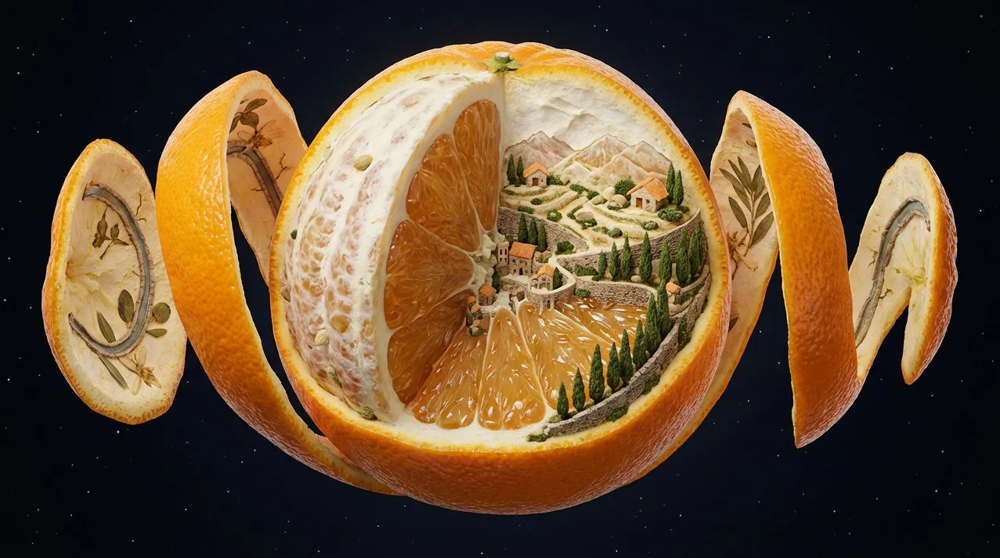

# Alexandra Aisling — by @AllaAisling

[← Back to Examples from X](../../EXAMPLES.md) · Category: Illustration & 3D · Model: `Nano Banana`

<a href="https://x.com/AllaAisling/status/2009646846830874963"></a>

Original post: **[@AllaAisling on X](https://x.com/AllaAisling/status/2009646846830874963)** · Creator: [Alexandra Aisling](https://x.com/AllaAisling)

## Prompt

```text
A single [OBJECT] suspended in space, frozen mid-peel as its outer skin curls away in ribbons. Beneath the surface exists a fully realized [INNER WORLD / SYSTEM] constructed entirely from the object's native material. The peeled layers themselves contain [EMBEDDED DETAILS / CROSS-SECTIONS / HIDDEN NARRATIVES] visible in their curl. Interior reveals [ORGANIC STRUCTURES / MECHANICAL SYSTEMS / ARCHITECTURAL SPACES] growing denser toward the core. Hyper-detailed 3D rendering with botanical illustration precision. Material continuity maintained throughout, [FIBER TEXTURES, MEMBRANE TRANSLUCENCY, CELLULAR PATTERNS] visible at macro scale. Palette restricted to [NATURAL MATERIAL GRADIENTS FROM SURFACE TO CORE]. Isolated object, soft directional lighting, museum-grade presentation. The peel tells one story, the interior tells another. Ultra-high resolution, scientific romanticism, collector-print quality.
```

## Try it

Paste the prompt into **[vinano.ai](https://vinano.ai?utm_source=github&utm_medium=readme&utm_campaign=awesome-image-video-prompts-updating&utm_content=x-page-try)** to generate your own version.

> The image and prompt belong to [@AllaAisling](https://x.com/AllaAisling) and are shown here with credit for reference. Creators can ask for changes or removal by opening an issue.
