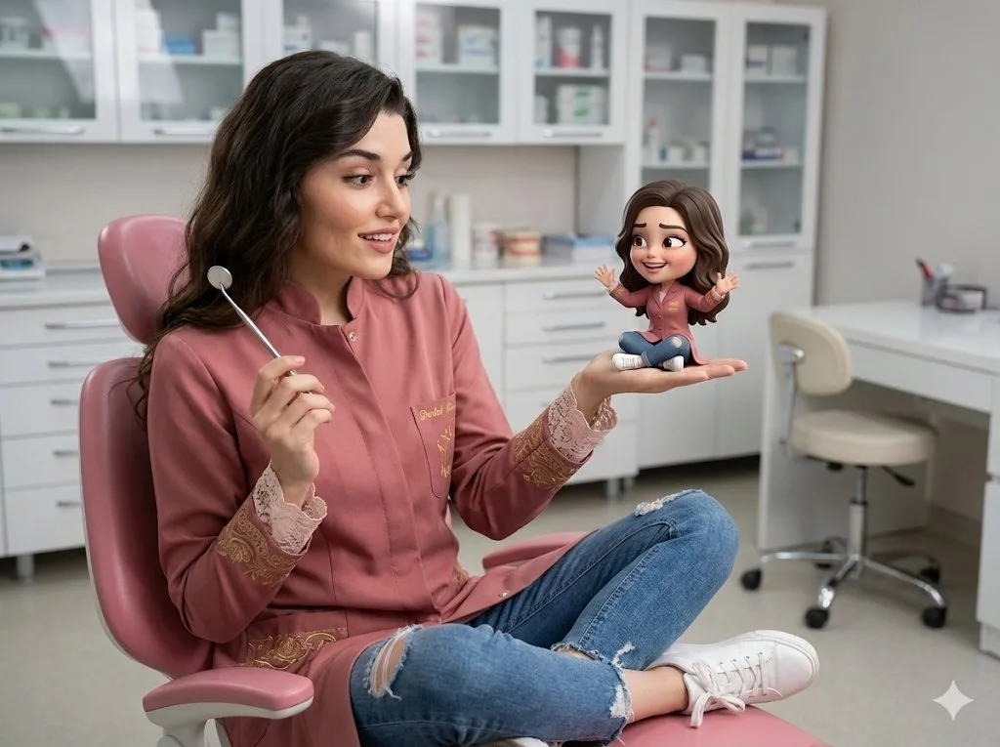

# Anissa — by @SimplyAnnisa

[← Back to Community Examples](../../EXAMPLES.md) · Category: Illustration & 3D · Model: `Nano Banana`

<a href="https://x.com/SimplyAnnisa/status/2009471280643493933"></a>

Source: **[@SimplyAnnisa on X](https://x.com/SimplyAnnisa/status/2009471280643493933)** · Creator: [Anissa](https://x.com/SimplyAnnisa)

## Prompt

```text
ME AND MY LITTLE 3D CHIBI IN THE OFFICE

Ultra-realistic cinematic portrait of an adult person, with the face fully visible, natural human skin texture with pores and subtle imperfections, and realistic hair strands. The real person is seated in a dental chair in a pink dental office, holding a small 3D miniature of themselves, delicately sitting with crossed legs in a relaxed pose on the palm of one hand. 4:3 horizontal ratio. Features dental office attire with a rose-colored coat and holding a dental mirror in hand.

The real person looks at the miniature with clear surprise and slight amusement, raised eyebrows, a soft smile, and expressive eyes. The facial expression appears spontaneous and authentic. The miniature closely resembles the real person in facial structure, hairstyle, and clothing, but rendered in a soft, high-quality 3D chibi style. The miniature has a funny and exaggerated facial expression, lively eyes, and playful moving arms and legs. The stylization is clean and modern, not like a toy, doll, or artificial figure.

Both characters wear matching outfits: medium distressed jeans, rose-colored coat with 3/4 bell sleeves finished with lace on cuffs and hems, embroidered with white lace and golden center details, and light white sneakers. Hair according to reference. Makeup: luminous and well-defined skin, light rosy blush, intense eyeshadow in neutral tones, black mascara on eyelashes, and matte pink lips. The scale difference between the realistic woman and the 3D chibi figure is obvious and visually amusing.

The background is a realistic office scene with white cabinets containing painting and creative items, a white desk, and a plastic swivel chair, with slight blur and strong depth of field. Professional cinematic lighting with clear separation of objects, soft highlights on the skin, and subtle rim light around both figures.

Ultra-detailed textures for the real person. Clean 3D textures with a realistic style for the miniature. Balanced between realism and humor. No surreal distortions.
```

## Try it

Paste the prompt into **[vinano.ai](https://vinano.ai?utm_source=github&utm_medium=readme&utm_campaign=awesome-image-video-prompts-updating&utm_content=x-page-try)** to generate your own version.

> The image and prompt belong to @SimplyAnnisa ([original post](https://x.com/SimplyAnnisa/status/2009471280643493933)) and are shown here with credit for reference. Creators can ask for changes or removal by opening an issue.
