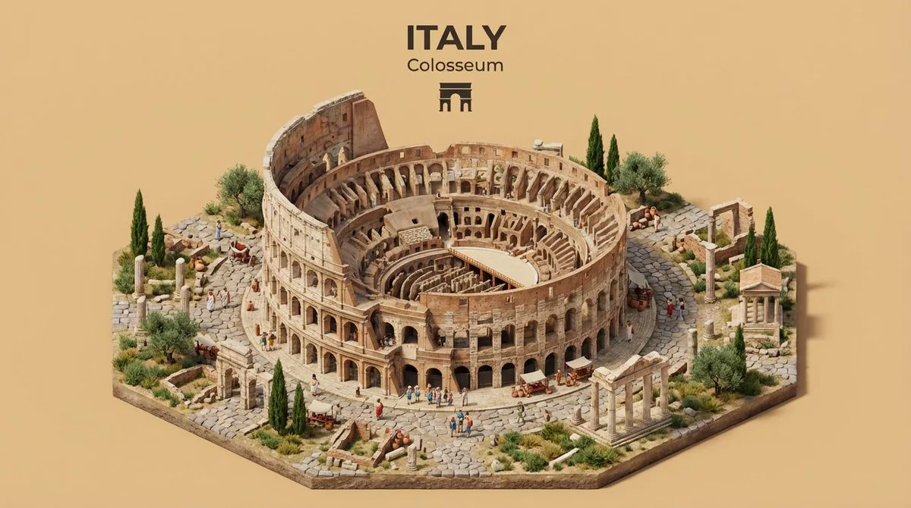

# Aleena Amir — by @aleenaamiir

[← Back to Examples from X](../../EXAMPLES.md) · Category: Illustration & 3D · Model: `Nano Banana`

<a href="https://x.com/aleenaamiir/status/2020714278744101061"></a>

Original post: **[@aleenaamiir on X](https://x.com/aleenaamiir/status/2020714278744101061)** · Creator: [Aleena Amir](https://x.com/aleenaamiir)

## Prompt

```text
\Create an isometric miniature 3D diorama representing the iconic architecture of [COUNTRY NAME] through [FAMOUS STRUCTURE]. Use a 45° top-down view.

Apply clean soft textures and realistic PBR materials.
Lighting feels balanced and natural. The raised base includes nearby streets, landscape features, and cultural details linked to the structure. Add tiny stylized locals and visitors with heavy facial details.

Background stays solid [BACKGROUND COLOR]. Top center text shows [COUNTRY NAME] in bold. Second line shows [STRUCTURE NAME]. Place a minimal architecture icon below. Text color adjusts for contrast.
```

## Try it

Paste the prompt into **[vinano.ai](https://vinano.ai?utm_source=github&utm_medium=readme&utm_campaign=awesome-image-video-prompts-updating&utm_content=x-page-try)** to generate your own version.

> The image and prompt belong to [@aleenaamiir](https://x.com/aleenaamiir) and are shown here with credit for reference. Creators can ask for changes or removal by opening an issue.
