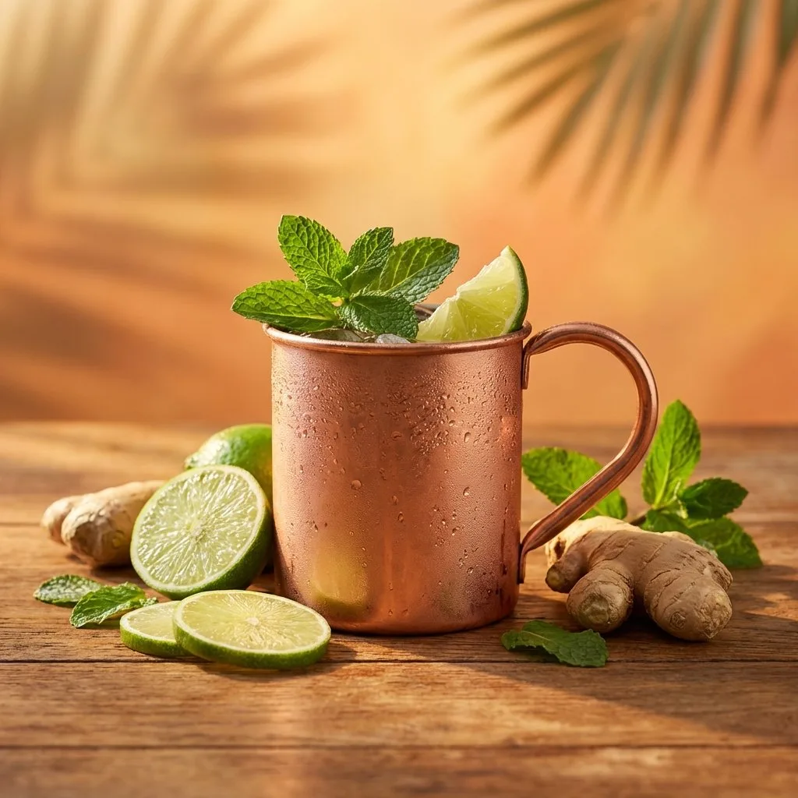

# Mo — by @Kerroudjm

[← Back to Examples from X](../../EXAMPLES.md) · Category: Food & Drink · Model: `Nano Banana`

<a href="https://x.com/Kerroudjm/status/2010403834699685983"></a>

Original post: **[@Kerroudjm on X](https://x.com/Kerroudjm/status/2010403834699685983)** · Creator: [Mo](https://x.com/Kerroudjm)

## Prompt

```text
A high-end studio photograph of a [YOUR COCKTAIL], shot from a high-angle slightly top-down perspective. The drink is served in its appropriate traditional glass with an elegant design and professional garnish. Artfully scattered around the base of the glass are fresh fruits and ingredients associated with the cocktail recipe. The scene features a warm, summery atmosphere with a light orange-tinted background. Artistic soft shadows of tropical palm leaves are cast across the frame, creating a vacation vibe. Realistic condensation on the glass, soft golden hour lighting, 8k resolution, professional food photography, sharp focus, clean and sophisticated composition.
```

## Try it

Paste the prompt into **[vinano.ai](https://vinano.ai?utm_source=github&utm_medium=readme&utm_campaign=awesome-image-video-prompts-updating&utm_content=x-page-try)** to generate your own version.

> The image and prompt belong to [@Kerroudjm](https://x.com/Kerroudjm) and are shown here with credit for reference. Creators can ask for changes or removal by opening an issue.
