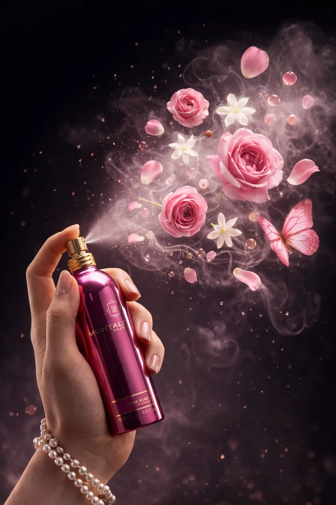

# ShaHid WaNii — by @meng_dagg695

[← Back to Community Examples](../../EXAMPLES.md) · Category: Product & Brand · Model: `Nano Banana`

<a href="https://x.com/meng_dagg695/status/2019001264416362931"></a>

Source: **[@meng_dagg695 on X](https://x.com/meng_dagg695/status/2019001264416362931)** · Creator: [ShaHid WaNii](https://x.com/meng_dagg695)

## Prompt

```text
{
  "resolution": "8K",
  "aspect_ratio": "3:4",
  "style": "high-end AI-edited studio photography",
  "subject": {
    "primary": "human hand holding a metallic pink perfume bottle",
    "hand_details": {
      "skin": "smooth, well-groomed",
      "nails": "short to medium length, natural nude tone",
      "accessory": "white pearl bracelet on wrist"
    },
    "bottle": {
      "material": "metallic reflective",
      "color": "deep metallic pink",
      "shape": "cylindrical with rounded shoulders",
      "nozzle": "gold spray nozzle, cap removed",
      "charm": {
        "material": "gold",
        "shape": "small geometric star-like tag",
        "attachment": "hanging from bottle neck via thin metal loop"
      },
      "visible_text": "MONTALE"
    }
  },
  "action": {
    "spray": {
      "type": "fine atomized mist",
      "direction": "left to right",
      "texture": "soft, smoke-like, semi-transparent"
    }
  },
  "elements_emerging_from_mist": {
    "flowers": {
      "pink_roses": "fully bloomed roses floating in air",
      "rose_petals": "individual pink petals suspended mid-air",
      "white_flowers": "small star-shaped white blossoms with thin petals"
    },
    "butterfly": {
      "color": "pink",
      "wings": "semi-translucent with visible veins",
      "position": "right side of frame"
    },
    "particles": {
      "type": "small glowing bokeh-like specks",
      "colors": ["soft pink", "warm gold"]
    }
  },
  "background": {
    "color": "dark black to deep brown gradient",
    "environment": "studio, no visible location"
  },
  "lighting": {
    "type": "soft cinematic studio lighting",
    "highlights": ["bottle curves", "gold nozzle", "mist", "flowers"],
    "contrast": "high subject-to-background contrast"
  },
  "composition": {
    "orientation": "vertical",
    "subject_position": "slightly left of center",
    "depth": "foreground hand, mid-air mist and flowers, dark background"
  },
  "quality": {
    "sharpness": "ultra-sharp",
    "detail_level": "extreme micro-detail",
    "finish": "luxury advertising grade"
  }
}
```

## Try it

Paste the prompt into **[vinano.ai](https://vinano.ai?utm_source=github&utm_medium=readme&utm_campaign=awesome-image-video-prompts-updating&utm_content=x-page-try)** to generate your own version.

> The image and prompt belong to @meng_dagg695 ([original post](https://x.com/meng_dagg695/status/2019001264416362931)) and are shown here with credit for reference. Creators can ask for changes or removal by opening an issue.
