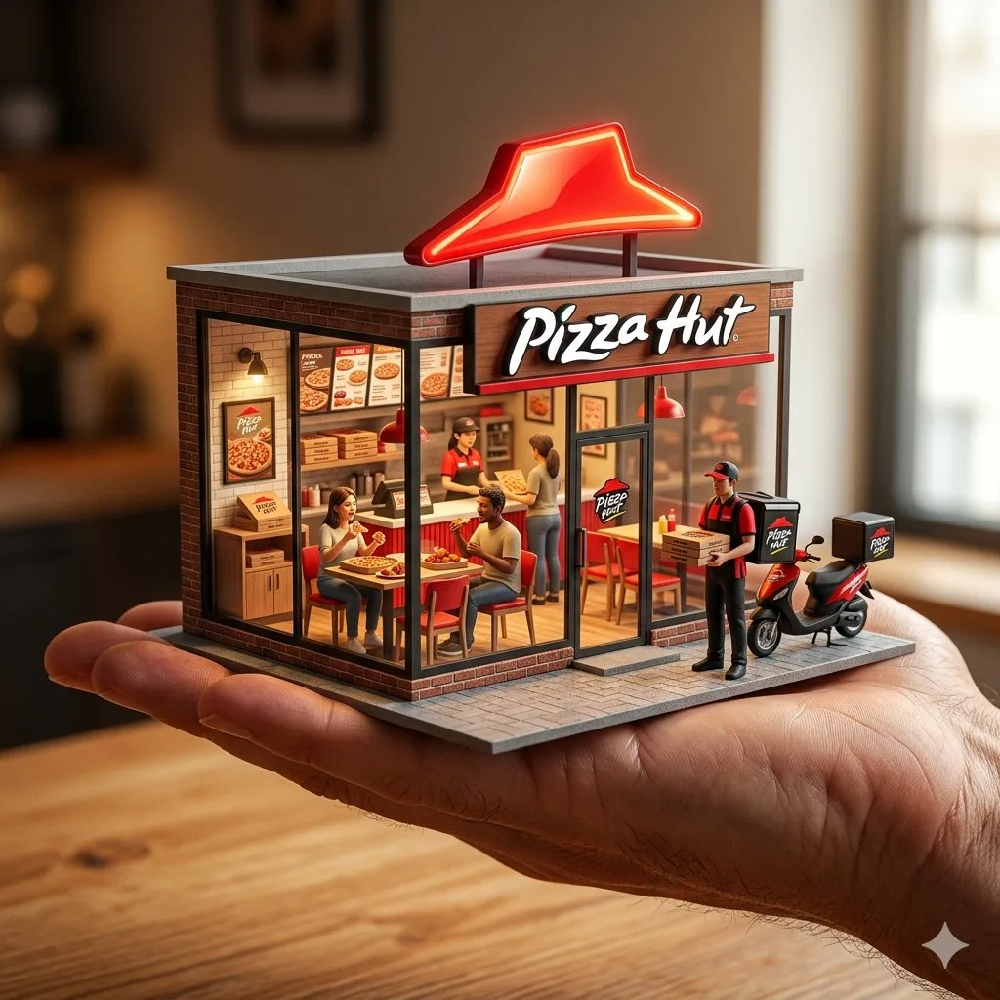

# simeon-sanai — by @Naiknelofar788

[← Back to Community Examples](../../EXAMPLES.md) · Category: Illustration & 3D · Model: `Nano Banana`

<a href="https://x.com/Naiknelofar788/status/2044605023557222629"></a>

Source: **[@Naiknelofar788 on X](https://x.com/Naiknelofar788/status/2044605023557222629)** · Creator: [simeon-sanai](https://x.com/Naiknelofar788)

## Prompt

```text
An ultra-realistic miniature [YOUR BRAND] showroom balanced on a human palm, designed with transparent glass walls. Inside, tiny lifelike figures are enjoying [PRODUCTS]. On the rooftop, a glowing 3D logo shines brightly, while the front facade displays the brand name in a bold, recognizable typeface. Outside the showroom, a miniature delivery person is standing with a branded delivery bag strapped to their back, ready to deliver orders.The showroom’s interior is styled like a cozy retail outlet, with miniature products and branding details on display. Lighting is cinematic with warm tones, crisp details, and natural shadows. Captured in professional product photography style, the scene conveys a vibrant, iconic, and instantly recognizable atmosphere. 1080x1080 dimension.
```

## Try it

Paste the prompt into **[vinano.ai](https://vinano.ai?utm_source=github&utm_medium=readme&utm_campaign=awesome-image-video-prompts-updating&utm_content=x-page-try)** to generate your own version.

> The image and prompt belong to @Naiknelofar788 ([original post](https://x.com/Naiknelofar788/status/2044605023557222629)) and are shown here with credit for reference. Creators can ask for changes or removal by opening an issue.
