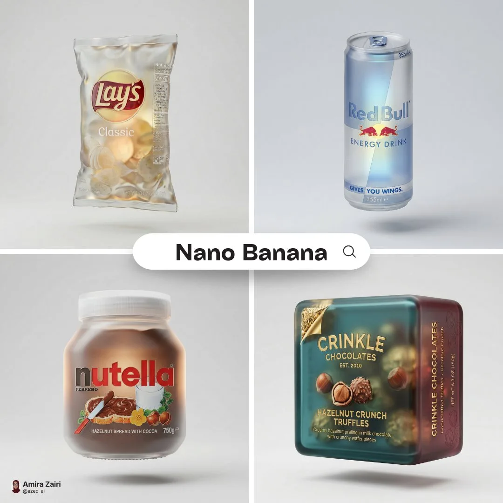

# Amira Zairi — by @azed_ai

[← Back to Community Examples](../../EXAMPLES.md) · Category: Illustration & 3D · Model: `Nano Banana`

<a href="https://x.com/azed_ai/status/2039704935194107907"></a>

Source: **[@azed_ai on X](https://x.com/azed_ai/status/2039704935194107907)** · Creator: [Amira Zairi](https://x.com/azed_ai)

## Prompt

```text
A hyper-detailed 3D frosted translucent glass version of the attached product packaging, maintaining accurate proportions and original colors, semi-transparent material with realistic refraction and soft internal glow, smooth softened corners, subtle surface texture, embossed branding details integrated into the glass, centered on a light gray background, floating gently with a soft shadow below, natural studio lighting, clean minimal layout, high-end product visualization style
```

## Try it

Paste the prompt into **[vinano.ai](https://vinano.ai?utm_source=github&utm_medium=readme&utm_campaign=awesome-image-video-prompts-updating&utm_content=x-page-try)** to generate your own version.

> The image and prompt belong to @azed_ai ([original post](https://x.com/azed_ai/status/2039704935194107907)) and are shown here with credit for reference. Creators can ask for changes or removal by opening an issue.
