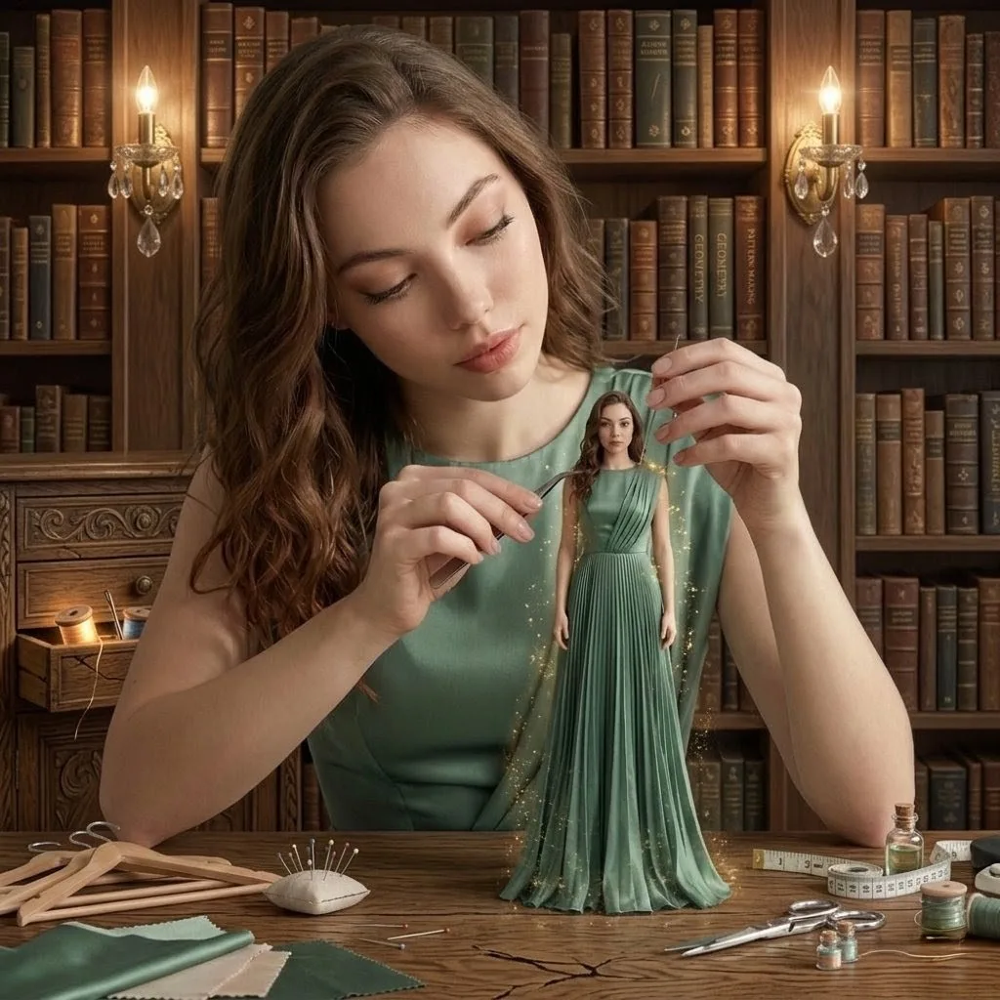

# Synthia — by @AIwithSynthia

[← Back to Examples from X](../../EXAMPLES.md) · Category: Photography · Model: `Nano Banana`

<a href="https://x.com/AIwithSynthia/status/2040304148516651431"></a>

Original post: **[@AIwithSynthia on X](https://x.com/AIwithSynthia/status/2040304148516651431)** · Creator: [Synthia](https://x.com/AIwithSynthia)

## Prompt

```text
A hyper-realistic cinematic scene of a young woman sitting at a wooden desk in a vintage library filled with old books. She is delicately holding and adjusting a tiny miniature version of herself standing on the table. The miniature woman wears an elegant flowing green dress with fine fabric details and subtle glowing particles around her. The larger woman looks focused and gentle, as if crafting or designing the tiny figure. Soft warm lighting from vintage wall lamps creates a cozy atmosphere, with sewing tools like scissors, threads, measuring tape, and fabric pieces scattered on the desk. Shallow depth of field, ultra-detailed, 8K, realistic skin textures, soft shadows, magical realism, cinematic composition.
```

## Try it

Paste the prompt into **[vinano.ai](https://vinano.ai?utm_source=github&utm_medium=readme&utm_campaign=awesome-image-video-prompts-updating&utm_content=x-page-try)** to generate your own version.

> The image and prompt belong to [@AIwithSynthia](https://x.com/AIwithSynthia) and are shown here with credit for reference. Creators can ask for changes or removal by opening an issue.
