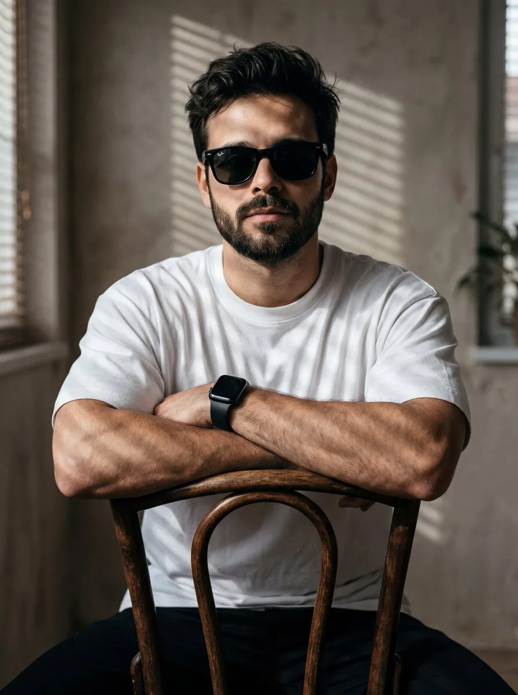

# Heisenberg — by @rovvmut_

[← Back to Community Examples](../../EXAMPLES.md) · Category: Photography · Model: `Nano Banana`

<a href="https://x.com/rovvmut_/status/2040832305925894162"></a>

Source: **[@rovvmut_ on X](https://x.com/rovvmut_/status/2040832305925894162)** · Creator: [Heisenberg](https://x.com/rovvmut_)

## Prompt

```text
A high-resolution, cinematic portrait of a young man with messy, voluminous dark hair and a well-groomed beard. He is wearing classic black wayfarer-style sunglasses and a clean, oversized white t-shirt. The man is seated backward on a vintage dark wood chair, resting his muscular, crossed forearms comfortably along the top of the curved backrest. On his left wrist, he wears a sleek black smartwatch with a rectangular face.

The scene is defined by dramatic, high-contrast lighting filtered through Venetian blinds, casting sharp, rhythmic horizontal shadow bars across his face, torso, and the textured, warm-grey plaster wall in the background. The atmosphere is moody and serene, with a shallow depth of field that keeps the focus sharp on the man’s expression and the texture of his hair, while the lower portion of the chair and his black trousers softly blur into the foreground. The color palette is neutral and sophisticated, dominated by crisp whites, deep blacks, and warm earthy wood tones.
```

## Try it

Paste the prompt into **[vinano.ai](https://vinano.ai?utm_source=github&utm_medium=readme&utm_campaign=awesome-image-video-prompts-updating&utm_content=x-page-try)** to generate your own version.

> The image and prompt belong to @rovvmut_ ([original post](https://x.com/rovvmut_/status/2040832305925894162)) and are shown here with credit for reference. Creators can ask for changes or removal by opening an issue.
