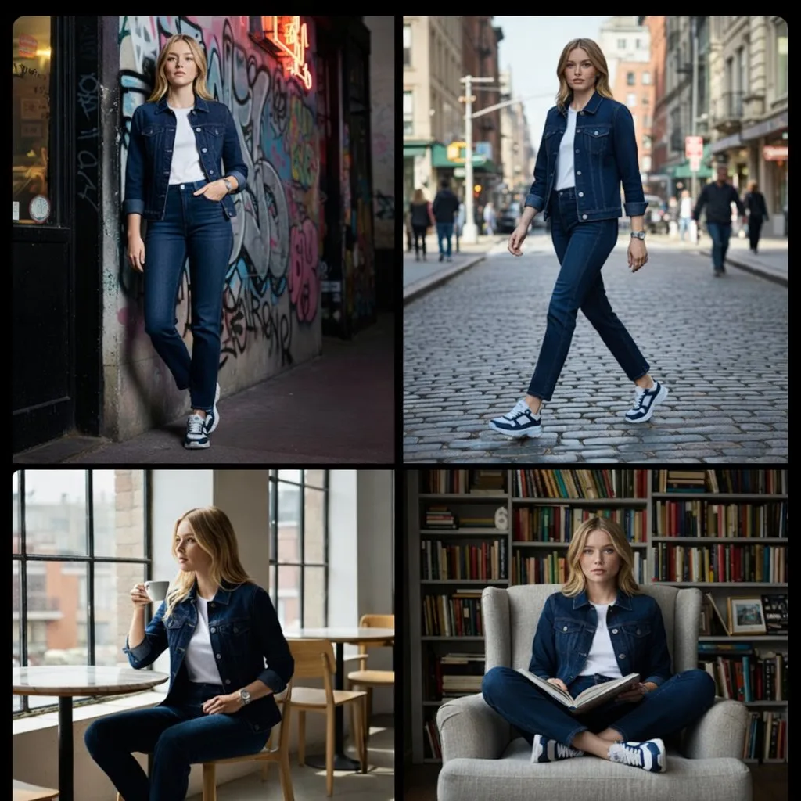

# Cherry 2.O — by @Mind_Boticni

[← Back to Community Examples](../../EXAMPLES.md) · Category: Photography · Model: `Nano Banana`

<a href="https://x.com/Mind_Boticni/status/2012881039266648492"></a>

Source: **[@Mind_Boticni on X](https://x.com/Mind_Boticni/status/2012881039266648492)** · Creator: [Cherry 2.O](https://x.com/Mind_Boticni)

## Prompt

```text
Hyper-realistic cinematic full-body fashion photoshoot of the uploaded woman (age 26, 5'5"), exact face and hairstyle from the uploaded image, perfectly styled. Leaning back confidently on a deep navy-blue bean bag, one arm resting on the edge of the bag, legs slightly apart, projecting calm confidence and poise. Wearing a bold all-navy look: navy blue denim jacket over a fitted white T-shirt, navy blue denim jeans, chunky sneakers, and a sleek silver watch. Solid navy-blue background, professional studio lighting, sharp focus, high fashion editorial aesthetic. provide four more photos.
```

## Try it

Paste the prompt into **[vinano.ai](https://vinano.ai?utm_source=github&utm_medium=readme&utm_campaign=awesome-image-video-prompts-updating&utm_content=x-page-try)** to generate your own version.

> The image and prompt belong to @Mind_Boticni ([original post](https://x.com/Mind_Boticni/status/2012881039266648492)) and are shown here with credit for reference. Creators can ask for changes or removal by opening an issue.
