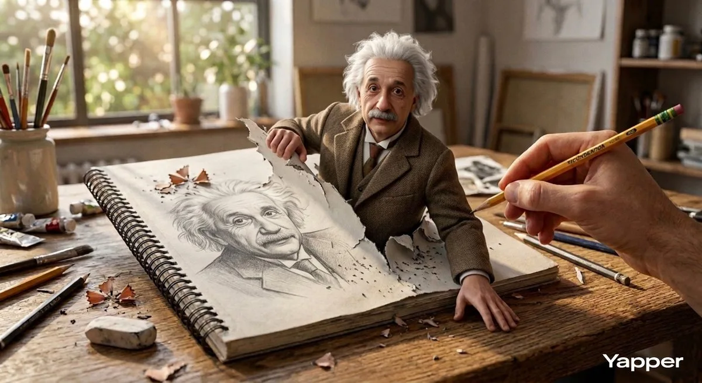

# Duet | AI — by @Sheldon056

[← Back to Community Examples](../../EXAMPLES.md) · Category: Illustration & 3D · Model: `Nano Banana`

<a href="https://x.com/Sheldon056/status/2029710685727592859"></a>

Source: **[@Sheldon056 on X](https://x.com/Sheldon056/status/2029710685727592859)** · Creator: [Duet | AI](https://x.com/Sheldon056)

## Prompt

```text
Hyper-realistic 3D illustration of Albert Einstein emerging from the pages of a sketchbook drawing, blending a graphite illustration with a lifelike 3D figure. Einstein has his iconic wild white hair, thick moustache, and thoughtful expression, wearing a classic brown tweed coat and white shirt.

The open sketchbook lies on a worn wooden artist desk inside a sunlit studio. The pages display a detailed graphite drawing of Albert Einstein, but the paper is dramatically torn and curling outward where Einstein pushes through, transitioning from a flat pencil drawing into a fully rendered 3D figure stepping into reality.

One of Einstein’s hands grips the torn edge of the paper while his other arm extends naturally outside the sketchbook, resting on the wooden desk as if stabilizing himself after stepping out of the drawing. His face shows curiosity and wonder, as if discovering the real world.

A realistic human hand holding a traditional yellow wooden pencil appears in the foreground near the drawing, suggesting the artist has just finished sketching him moments before he came alive.

Around the desk are pencil shavings, a large white eraser, graphite pencils, scattered sketches, paintbrushes, and glass jars filled with art tools. Warm sunlight from a large window illuminates the studio, casting soft shadows and highlighting the textures of paper fibers, graphite shading, wood grain, and skin details. Ultra-realistic rendering, cinematic lighting, high resolution, extremely detailed.
```

## Try it

Paste the prompt into **[vinano.ai](https://vinano.ai?utm_source=github&utm_medium=readme&utm_campaign=awesome-image-video-prompts-updating&utm_content=x-page-try)** to generate your own version.

> The image and prompt belong to @Sheldon056 ([original post](https://x.com/Sheldon056/status/2029710685727592859)) and are shown here with credit for reference. Creators can ask for changes or removal by opening an issue.
