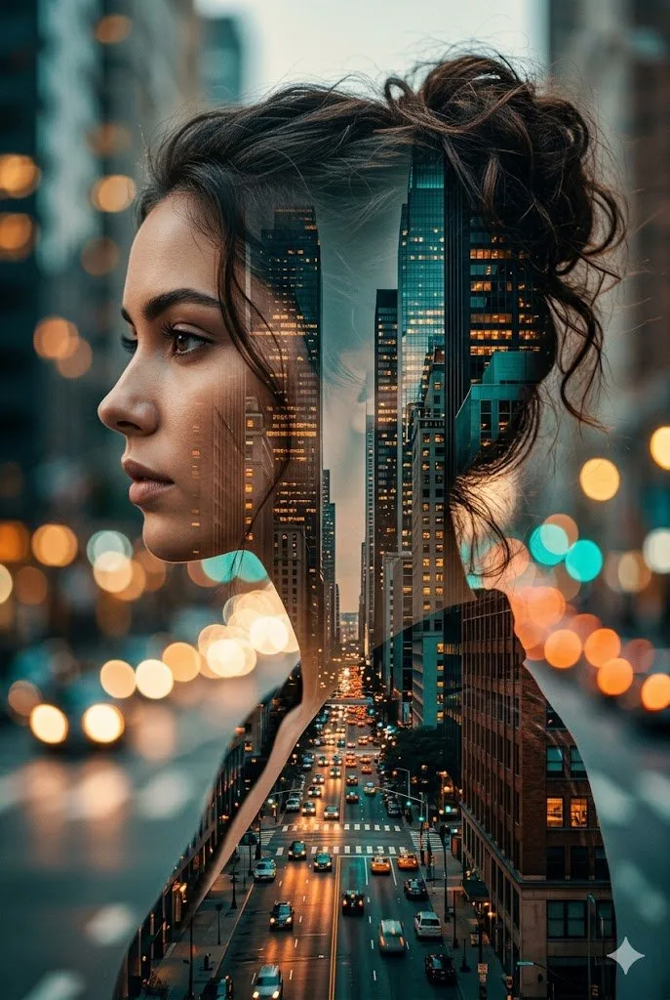

# Cherry 2.O — by @Mind_Boticni

[← Back to Community Examples](../../EXAMPLES.md) · Category: Photography · Model: `Nano Banana`

<a href="https://x.com/Mind_Boticni/status/2040827971720925552"></a>

Source: **[@Mind_Boticni on X](https://x.com/Mind_Boticni/status/2040827971720925552)** · Creator: [Cherry 2.O](https://x.com/Mind_Boticni)

## Prompt

```text
A cinematic double exposure portrait of a young woman hollywood actress in profile, her hair in a messy bun, overlaid with a busy city street scene with tall buildings, warm orange and teal tones, soft bokeh lights in the background, high detail, realistic lighting, vertical composition, photorealistic style.
```

## Try it

Paste the prompt into **[vinano.ai](https://vinano.ai?utm_source=github&utm_medium=readme&utm_campaign=awesome-image-video-prompts-updating&utm_content=x-page-try)** to generate your own version.

> The image and prompt belong to @Mind_Boticni ([original post](https://x.com/Mind_Boticni/status/2040827971720925552)) and are shown here with credit for reference. Creators can ask for changes or removal by opening an issue.
