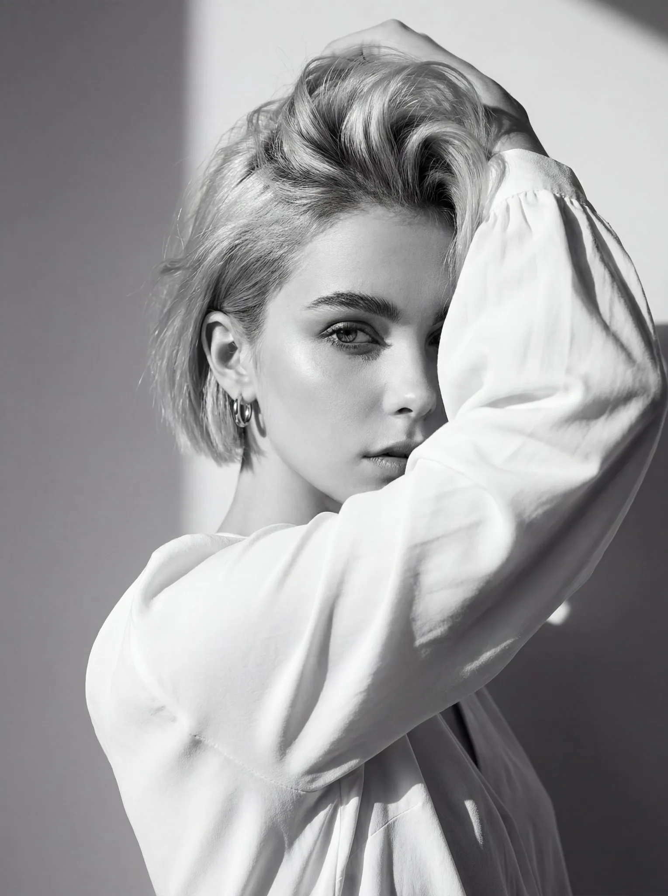

# K — by @ChillaiKalan__

[← Back to Examples from X](../../EXAMPLES.md) · Category: Photography · Model: `Nano Banana`

<a href="https://x.com/ChillaiKalan__/status/2010663134743368058"></a>

Original post: **[@ChillaiKalan__ on X](https://x.com/ChillaiKalan__/status/2010663134743368058)** · Creator: [K](https://x.com/ChillaiKalan__)

## Prompt

```text
Use the attached image of the model as facial reference and physical features. Black and white high-fashion editorial portrait of uploaded person, wearing a loose white blouse. She poses with one arm raised, partially covering her face while holding her hair up, creating a dramatic and artistic composition. Her gaze is intense and captivating, directed toward the camera, exuding a strong, enigmatic aura. Background: minimalist plain wall with sharp natural daylight casting defined shadows, adding depth and contrast. Lighting: harsh natural sunlight, high-contrast setup highlighting facial contours, sharp cheekbones, and texture of the hair and fabric. Pose: bold and expressive, arm lifted framing the face, emphasizing raw emotion and editorial style. Camera: eye-level angle, close-up framing focusing on facial expression, texture, and dramatic shadow play. Captured with a Canon EOS R5 full-frame DSLR, 85mm f/1.8 lens for crisp detail, tonal depth, and fine grain. Style: high-fashion editorial in monochrome.
```

## Try it

Paste the prompt into **[vinano.ai](https://vinano.ai?utm_source=github&utm_medium=readme&utm_campaign=awesome-image-video-prompts-updating&utm_content=x-page-try)** to generate your own version.

> The image and prompt belong to [@ChillaiKalan__](https://x.com/ChillaiKalan__) and are shown here with credit for reference. Creators can ask for changes or removal by opening an issue.
