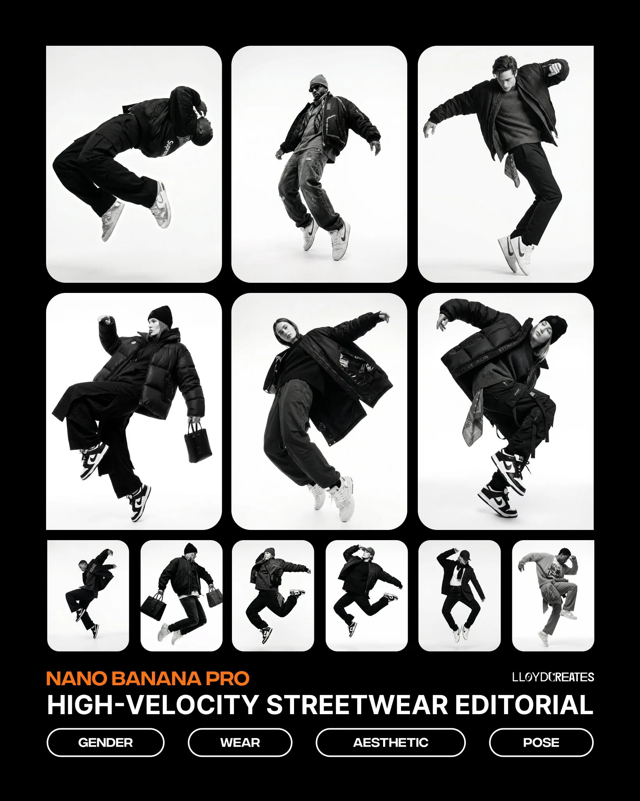

# Lloyd Creates — by @lloydcreates

[← Back to Community Examples](../../EXAMPLES.md) · Category: Photography · Model: `Nano Banana`

<a href="https://x.com/lloydcreates/status/2009813602660712485"></a>

Source: **[@lloydcreates on X](https://x.com/lloydcreates/status/2009813602660712485)** · Creator: [Lloyd Creates](https://x.com/lloydcreates)

## Prompt

```text
{
  "subject_gender_placeholder": "[CHOOSE: woman]",
  "aesthetic_lodestar": "cinematic luxury hypebeast editorial, strictly monochrome, shadowless stasis, deep rich blacks, single-frame photograph",
  "composition": {
    "frame": "minimalist controlled studio, clinical stark clarity, extremely dynamic camera angles capturing the action from aggressive low or high perspectives. No grid layouts, solitary subject focus.",
    "background": "pure, seamless, blown-out white infinite void, completely free of floor or wall shadows",
    "focus": "razor-sharp deep focus across the entire subject in motion"
  },
  "subject_action": {
    "pose": "impossible, gravity-defying airborne contortions and explosive mid-air leaps, frozen at the absolute peak of movement with extreme bodily tension",
    "energy": "maximum athletic tension meets high-fashion structure, controlled chaos suspended in time, creating sculptural, almost unbelievable silhouettes against the void"
  },
  "wardrobe_styling": {
    "vibe": "creative street fashion x avant-garde tailoring, non-provocative, clean and impactful silhouettes with varied layering",
    "garment_variations": [
      "Open cardigan sweaters layered over premium t-shirts",
      "Oversized knitwear and structured lounger sweaters",
      "Technical bomber jackets or varsity jackets",
      "Japanese minimalist silhouettes (unstructured, flowing, layered)",
      "Premium denim jackets and jeans styles",
      "Japanese Americana wear and styles",
      "Moncler puffer jackets",
      "Statement structured outerwear (as previously defined)"
    ],
    "brands_reference": ["Supreme", "Fear of God", "Maison Margiela", "Martine Rose", "UMBRO", "Aimé Leon Dore", "RHUDE", "Maison Kitsuné", "NikeLab", "Moncler", "Issey Miyake"],
    "accessories": {
      "general": "scarves, neck bandanas, paisley bandanas hanging from pockets (used sparingly when sensible)",
      "womens_specific": "Avant-Garde style bags, Saint Laurent structured totes or crossbodies, designer baseball caps, trucker caps, premium wool beanies (applied only if subject is woman)"
 "details": "only apply head gear objects on the subject's head, nowhere else"
    },
    "key_details": "focus on singular statement outfits without excessive bulk, oversized cuts contrasting with sharp tailoring, prominent branding, varied fabric weights rendered through pure texture without shadow"
  },
  "footwear_focus": {
    "models": ["Nike SB Dunk", "Off-White™ x Nike deconstructed models", "Converse Chuck 70 premium high-top", "Vans Vault Slip-On", “Adidas Samba”, “New Balance 327”, “ASICS Onitsuka Tiger Sneakers”],
    "details": "the only object on the subject's feet, highly visible and pristine, forming the anchor point of the dynamic motion"
  },
  "visual_color_treatment": {
    "base_spectrum": "pure, uncompromising black and white with ultra-deep, rich black tones",
    "blend_mode": "cohesive fusion of extreme textural contrasts and shadowless spectral lighting",
    "palette_components": {
      "rich_matte_black": "pure light-absorbing wools, denim, and heavy cottons, vantablack-like density, crushing blacks for maximum depth rendered solely through surface texture",
      "high_sheen_monochrome": "polished leather, reflective technical nylon, glossy polymers catching pure white specular highlights without casting shadows",
      "monochrome_solarization": "ghostly spectral edge-lighting, inverted luminance highlights defining folds and outlines, stark, hyper-contrasted glowing edges"
    }
  },
  "lighting_dynamics": "flat, high-key, omnidirectional diffused studio lighting. Zero cast shadows on subjects, floor, or background. Form and depth are flattened, relying entirely on the stark contrast between glossy surfaces, crushed rich blacks, and the glowing solarized edge contours for definition."
}
```

## Try it

Paste the prompt into **[vinano.ai](https://vinano.ai?utm_source=github&utm_medium=readme&utm_campaign=awesome-image-video-prompts-updating&utm_content=x-page-try)** to generate your own version.

> The image and prompt belong to @lloydcreates ([original post](https://x.com/lloydcreates/status/2009813602660712485)) and are shown here with credit for reference. Creators can ask for changes or removal by opening an issue.
