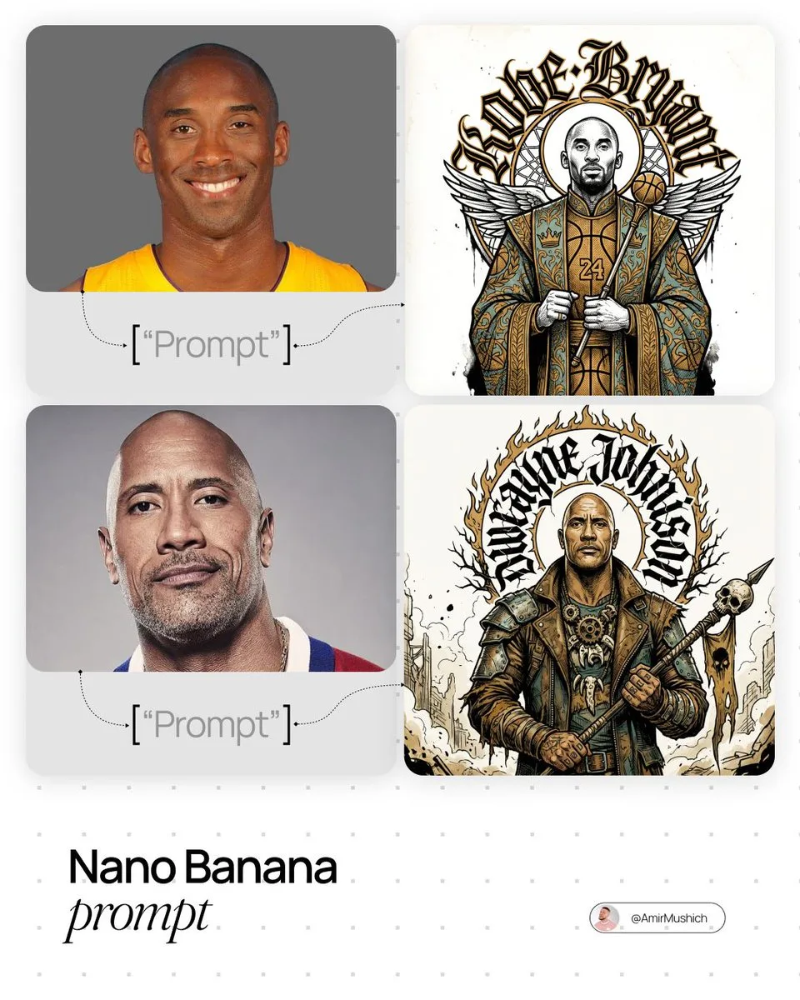

# AmirMušić — by @AmirMushich

[← Back to Examples from X](../../EXAMPLES.md) · Category: Illustration & 3D · Model: `Nano Banana`

<a href="https://x.com/AmirMushich/status/2023079918830002551"></a>

Original post: **[@AmirMushich on X](https://x.com/AmirMushich/status/2023079918830002551)** · Creator: [AmirMušić](https://x.com/AmirMushich)

## Prompt

```text
[PERSONE]. Act as a Creative Director and Master of Visual Metaphor.

PHASE 1: DYNAMIC ARCHETYPE LOGIC.

Autonomously analyze the core essence of [PERSONE] and assign them a "High-Status Sovereign" role:

- If the character is a scientist/intellectual: Depict as a "Grand Archivist" in heavy velvet robes with celestial instruments.

- If the character is a rebel/anti-hero: Depict as a "Wasteland Prophet" in deconstructed, layered streetwear and scavenged textures.

- If the character is royalty/leader: Depict as a "Divine Monarch" in stiff, ornamental ceremonial attire.

- Maintain the stoic, iconographic pose from the reference.

PHASE 2: ART STYLE & INK (THE REFERENCE LOOK).

Strictly follow the "Neo-Traditional Etching" style. 

- Bold black ink outlines, intricate cross-hatching, and stippling for shadows. 

- Color Palette: Deep Ochre, Faded Teal, Jet Black, and Bone White background.

PHASE 3: DYNAMIC TYPOGRAPHY.

- The massive Gothic/Blackletter halo behind the subject MUST explicitly spell out the name "[PERSONE]". 

- The font style should adapt to the archetype (e.g., sharp and aggressive for rebels, elegant and structured for scholars).

TECH SPECS:

2D flat illustration, white background, ink-bleed effects, high contrast, sharp line-work.
```

## Try it

Paste the prompt into **[vinano.ai](https://vinano.ai?utm_source=github&utm_medium=readme&utm_campaign=awesome-image-video-prompts-updating&utm_content=x-page-try)** to generate your own version.

> The image and prompt belong to [@AmirMushich](https://x.com/AmirMushich) and are shown here with credit for reference. Creators can ask for changes or removal by opening an issue.
