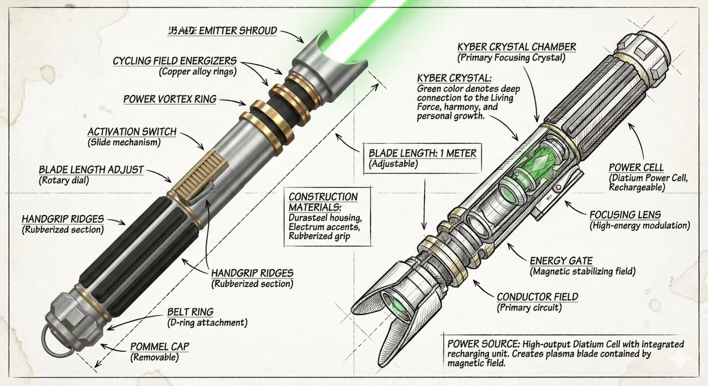

# Kaan — by @kaanakz

[← Back to Community Examples](../../EXAMPLES.md) · Category: Product & Brand · Model: `Nano Banana`

<a href="https://x.com/kaanakz/status/2017678718882476378"></a>

Source: **[@kaanakz on X](https://x.com/kaanakz/status/2017678718882476378)** · Creator: [Kaan](https://x.com/kaanakz)

## Prompt

```text
Create an infographic image of Nike Air Jordan 1 High OG sneaker, combining a realistic photograph or photoreal render of the object with technical annotation overlays placed directly on top. Use black ink–style line drawings and text (technical pen / engineering diagram aesthetic) for all annotations. Include precise arrows pointing to specific parts, detailed labels naming each component (toe box, swoosh logo, wings logo, collar, tongue, lace holes, midsole, outsole, heel counter, perforations, stitching patterns), materials used (premium leather, rubber outsole, foam cushioning), and historical notes (designed by Peter Moore, 1985, banned by NBA). Show both side profile and slight 3/4 angle. Background should be clean white or very light neutral. Overall style: a hybrid of product photography and vintage technical manual illustration. High resolution, ultra-detailed, 4K quality.
```

## Try it

Paste the prompt into **[vinano.ai](https://vinano.ai?utm_source=github&utm_medium=readme&utm_campaign=awesome-image-video-prompts-updating&utm_content=x-page-try)** to generate your own version.

> The image and prompt belong to @kaanakz ([original post](https://x.com/kaanakz/status/2017678718882476378)) and are shown here with credit for reference. Creators can ask for changes or removal by opening an issue.
