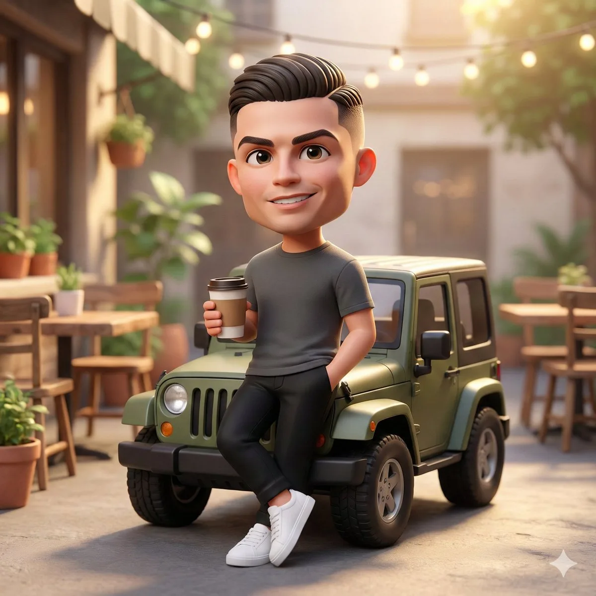

# Smiling Khan — by @AIwithkhan

[← Back to Examples from X](../../EXAMPLES.md) · Category: Illustration & 3D · Model: `Nano Banana`

<a href="https://x.com/AIwithkhan/status/2011097903599927573"></a>

Original post: **[@AIwithkhan on X](https://x.com/AIwithkhan/status/2011097903599927573)** · Creator: [Smiling Khan](https://x.com/AIwithkhan)

## Prompt

```text
A cute 3D chibi-style character leaning against a parked mini chibi Jeep, wearing a clean monochrome outfit: plain t-shirt, straight-fit pants, and minimalist sneakers. Holding a takeaway coffee cup, relaxed confident smile. Big head, expressive eyes, modern fade haircut. Cozy café courtyard with wooden chairs, warm sunlight, soft depth of field, Pixar-quality 3D render, playful yet premium aesthetic, square aspect rat
```

## Try it

Paste the prompt into **[vinano.ai](https://vinano.ai?utm_source=github&utm_medium=readme&utm_campaign=awesome-image-video-prompts-updating&utm_content=x-page-try)** to generate your own version.

> The image and prompt belong to [@AIwithkhan](https://x.com/AIwithkhan) and are shown here with credit for reference. Creators can ask for changes or removal by opening an issue.
