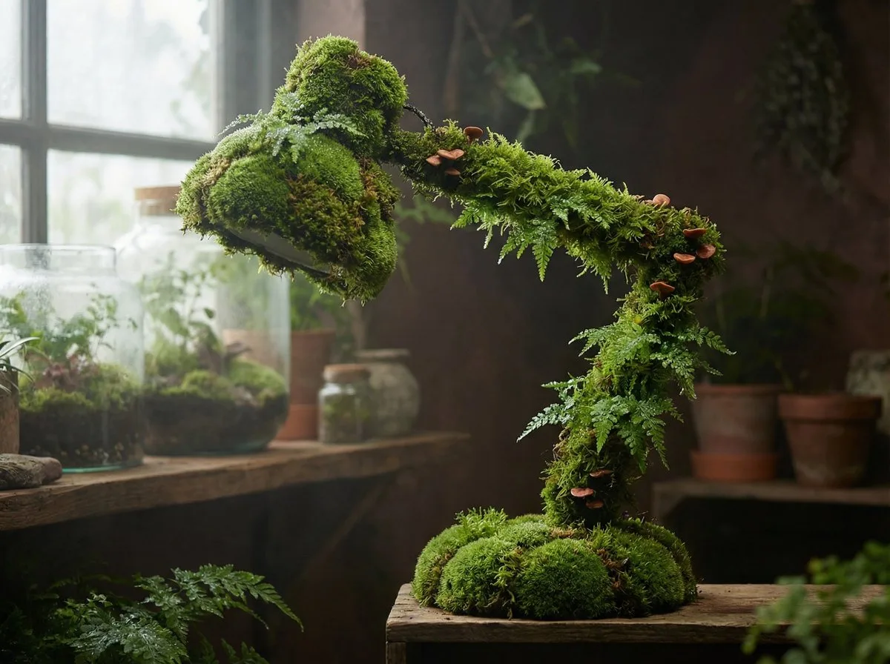

# Alexandra Aisling — by @AllaAisling

[← Back to Examples from X](../../EXAMPLES.md) · Category: Illustration & 3D · Model: `Nano Banana`

<a href="https://x.com/AllaAisling/status/2015443794217361458"></a>

Original post: **[@AllaAisling on X](https://x.com/AllaAisling/status/2015443794217361458)** · Creator: [Alexandra Aisling](https://x.com/AllaAisling)

## Prompt

```text
A [PRODUCT] rendered as if entirely grown from living moss, perfectly maintaining product form while being undeniably alive and soft. Different moss varieties create texture variation: smooth cushion moss for flat surfaces, feathery fern moss for details, tiny fruiting bodies as accent points. Damp, verdant, breathing. Positioned in a botanical studio setting or against dark earth tones. Biophilic design meets product photography. Soft natural lighting emphasizing the life, the moisture, the green depth. Sharp focus, saturated natural greens, wellness brand aesthetic, ultra-high resolution, the manufactured made living.
```

## Try it

Paste the prompt into **[vinano.ai](https://vinano.ai?utm_source=github&utm_medium=readme&utm_campaign=awesome-image-video-prompts-updating&utm_content=x-page-try)** to generate your own version.

> The image and prompt belong to [@AllaAisling](https://x.com/AllaAisling) and are shown here with credit for reference. Creators can ask for changes or removal by opening an issue.
