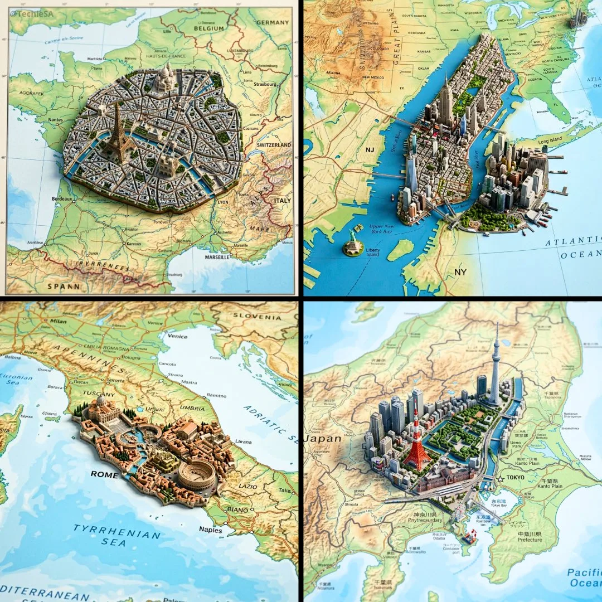

# TechieSA — by @TechieBySA

[← Back to Examples from X](../../EXAMPLES.md) · Category: Illustration & 3D · Model: `Nano Banana`

<a href="https://x.com/TechieBySA/status/2027843262497591580"></a>

Original post: **[@TechieBySA on X](https://x.com/TechieBySA/status/2027843262497591580)** · Creator: [TechieSA](https://x.com/TechieBySA)

## Prompt

```text
Ultra-realistic top-down geographic map with precise cartographic accuracy, clearly defining the true geographic context of [COUNTRY].

From the exact real-world coordinates of [CITY], a highly detailed miniature 3D diorama rises organically from the map surface, perfectly aligned with its true location.

The diorama features iconic architecture, signature natural landmarks, and authentic cultural elements of the city, seamlessly integrated into the map as if sculpted from it.

Physically accurate materials, realistic surface textures, and true-to-scale proportions.

Shallow depth of field with macro-lens realism, subtle atmospheric perspective.

Soft neutral studio lighting with controlled shadows to enhance depth and realism.

Cinematic composition, premium architectural-model photography style.

Ultra-sharp detail, high dynamic range, photorealistic finish.
Square 1:1 format, realistic scale, museum-quality visual output.
```

## Try it

Paste the prompt into **[vinano.ai](https://vinano.ai?utm_source=github&utm_medium=readme&utm_campaign=awesome-image-video-prompts-updating&utm_content=x-page-try)** to generate your own version.

> The image and prompt belong to [@TechieBySA](https://x.com/TechieBySA) and are shown here with credit for reference. Creators can ask for changes or removal by opening an issue.
