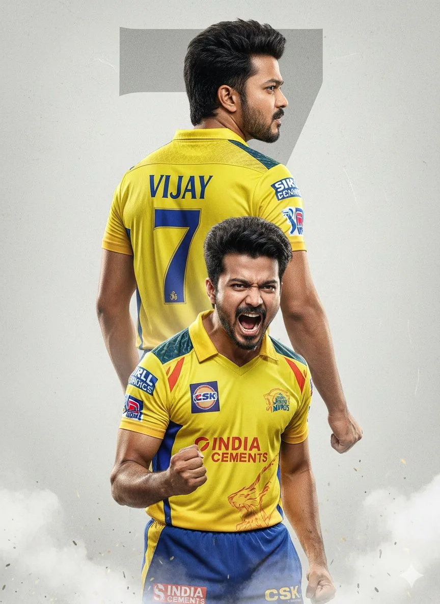

# ராஜேஷ் — by @r4jjesh

[← Back to Community Examples](../../EXAMPLES.md) · Category: Photography · Model: `Nano Banana`

<a href="https://x.com/r4jjesh/status/2018214780935549253"></a>

Source: **[@r4jjesh on X](https://x.com/r4jjesh/status/2018214780935549253)** · Creator: [ராஜேஷ்](https://x.com/r4jjesh)

## Prompt

```text
An ultra-realistic cinematic cricket poster featuring a young Indian male cricketer using the uploaded reference face exactly (100% facial accuracy). He has a fair-whitish glass skin tone, soft red lips, sharp jawline, light stubble beard, and a voluminous slightly messy fade mullet hairstyle with natural texture. The composition is a triple-layer cinematic layout on a clean, textured light-grey studio background, with a large, softly embedded “77” subtly visible behind the subject. Primary dominant pose (upper background): The cricketer is shown from the back, standing tall and confident, wearing an official Chennai Super Kings (CSK) jersey in bright yellow with blue accents. Bold blue typography on the jersey reads “VIJAY” with the number “77” below it. His athletic physique is emphasized, shoulders squared, as he slightly turns his head over the shoulder, revealing an intense, fearless side profile. Foreground action pose (half body): A powerful celebration moment captures him mid-roar, mouth open in victory, right fist clenched and arm flexed. He wears the complete CSK match kit, including yellow-blue trousers, and ground texture. The CSK logo and sponsor details appear authentic and sharp. Sweat highlights on the skin add realism, with cinematic rim lighting separating the face from the background. Atmosphere & lighting: Premium cinematic studio lighting with balanced highlights and shadows enhances fabric folds, muscle definition, and facial contours. Subtle smoke and dust effects rise from the base, adding intensity without obscuring details. No blur, no distortion. Camera & quality: DSLR photography look, 85mm lens feel, shallow depth where needed, ultra-sharp focus, realistic proportions, professional color grading with rich yellow, blue, and gold tones. Photorealistic, 8K resolution, vertical poster composition, IPL magazine-cover style. No cartoon look, no extra limbs, no facial alteration, no watermark.

RCB :

An ultra-realistic cinematic cricket poster featuring a young Indian male cricketer using the uploaded reference face exactly (100% facial accuracy). He has a fair-whitish glass skin tone, soft red lips, sharp jawline, light stubble beard, and a voluminous slightly messy fade mullet hairstyle with natural texture.
The composition is a triple-layer cinematic layout on a clean, textured light-grey studio background, with a large, softly embedded “3” subtly visible behind the subject.
Primary dominant pose (upper background):
The cricketer is shown from the back, standing tall and confident, wearing an official Royal Challengers Bangalore (RCB) jersey in deep red and black with gold accents. Bold golden typography on the jersey reads “STR” with the number “33” below it. His athletic physique is emphasized, shoulders squared, as he slightly turns his head over the shoulder, revealing an intense, fearless side profile.
Foreground action pose (half body):
A powerful celebration moment captures him mid-roar, mouth open in victory, right fist clenched and arm flexed. He wears the complete RCB match kit, including black-red trousers, and ground texture. The RCB logo and sponsor details appear authentic and sharp.
Sweat highlights on the skin add realism, with cinematic rim lighting separating the face from the background.
Atmosphere & lighting:
Premium cinematic studio lighting with balanced highlights and shadows enhances fabric folds, muscle definition, and facial contours. Subtle smoke and dust effects rise from the base, adding intensity without obscuring details. No blur, no distortion.
Camera & quality:
DSLR photography look, 85mm lens feel, shallow depth where needed, ultra-sharp focus, realistic proportions, professional color grading with rich reds, blacks, and gold tones.
Photorealistic, 8K resolution, vertical poster composition, IPL magazine-cover style.
No cartoon look, no extra limbs, no facial alteration, no watermark.
```

## Try it

Paste the prompt into **[vinano.ai](https://vinano.ai?utm_source=github&utm_medium=readme&utm_campaign=awesome-image-video-prompts-updating&utm_content=x-page-try)** to generate your own version.

> The image and prompt belong to @r4jjesh ([original post](https://x.com/r4jjesh/status/2018214780935549253)) and are shown here with credit for reference. Creators can ask for changes or removal by opening an issue.
