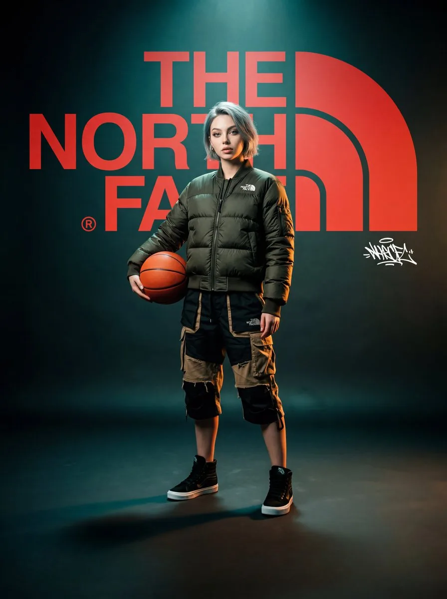

# Heisenberg — by @rovvmut_

[← Back to Examples from X](../../EXAMPLES.md) · Category: Product & Brand · Model: `Nano Banana`

<a href="https://x.com/rovvmut_/status/2041451587403399395"></a>

Original post: **[@rovvmut_ on X](https://x.com/rovvmut_/status/2041451587403399395)** · Creator: [Heisenberg](https://x.com/rovvmut_)

## Prompt

```text
A high-fashion, cinematic brand concept poster for "The North Face." The scene features a woman in the uploaded image, standing in a stylized studio. They are dressed in edgy, oversized urban streetwear: a dark olive-green quilted puffer bomber jacket, layered black and tan distressed techwear shorts below knees, and black sneakers with white soles. The person holds a classic orange basketball at their hip. In the background, a massive, bold red "THE NORTH FACE" logo and its iconic half-dome symbol are stacked and centered, dominating the upper half of the frame. To the right of the subject, there's a small white stylized graffiti-style signature. The lighting is moody and dramatic, featuring a teal-tinted atmosphere with a warm rim light hitting the subject’s right side. The floor is a dark, smooth studio surface with a soft shadow cast forward. The overall aesthetic is gritty, futuristic, and high-contrast, with a heavy film grain texture.
```

## Try it

Paste the prompt into **[vinano.ai](https://vinano.ai?utm_source=github&utm_medium=readme&utm_campaign=awesome-image-video-prompts-updating&utm_content=x-page-try)** to generate your own version.

> The image and prompt belong to [@rovvmut_](https://x.com/rovvmut_) and are shown here with credit for reference. Creators can ask for changes or removal by opening an issue.
