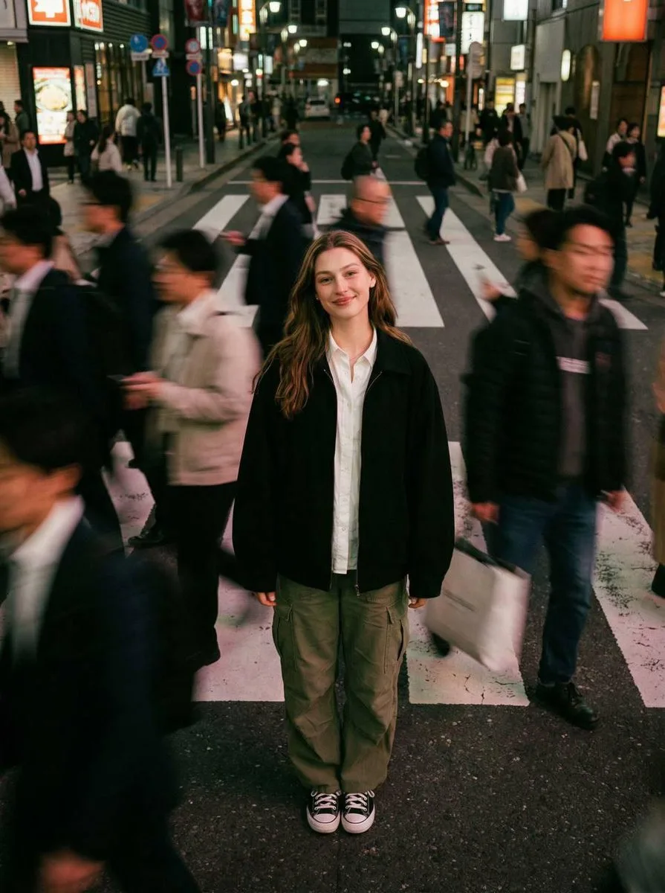

# simply — by @kingofdairyque

[← Back to Community Examples](../../EXAMPLES.md) · Category: Photography · Model: `Nano Banana`

<a href="https://x.com/kingofdairyque/status/2011249682153132335"></a>

Source: **[@kingofdairyque on X](https://x.com/kingofdairyque/status/2011249682153132335)** · Creator: [simply](https://x.com/kingofdairyque)

## Prompt

```text
Cinematic street photography capturing a moment in motion with a crowd blur effect. Overhead portrait of me standing still on a crosswalk, wearing a white button-up shirt, black oversized jacket, and olive green cargo pants. Motion-blurred crowd rushes past. Moody city lighting, 35mm film aesthetic, shallow depth of field, sharp focus on my portrait, showcasing an artistic and timeless style.
```

## Try it

Paste the prompt into **[vinano.ai](https://vinano.ai?utm_source=github&utm_medium=readme&utm_campaign=awesome-image-video-prompts-updating&utm_content=x-page-try)** to generate your own version.

> The image and prompt belong to @kingofdairyque ([original post](https://x.com/kingofdairyque/status/2011249682153132335)) and are shown here with credit for reference. Creators can ask for changes or removal by opening an issue.
