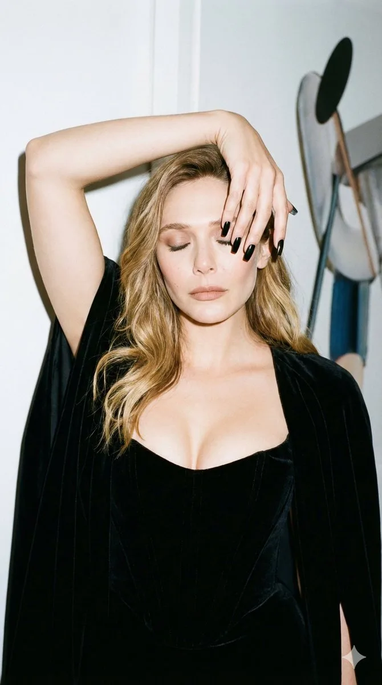

# Lex — by @lexx_aura

[← Back to Community Examples](../../EXAMPLES.md) · Category: Photography · Model: `Nano Banana`

<a href="https://x.com/lexx_aura/status/2011830747439481225"></a>

Source: **[@lexx_aura on X](https://x.com/lexx_aura/status/2011830747439481225)** · Creator: [Lex](https://x.com/lexx_aura)

## Prompt

```text
{
  "image_style": {
    "type": "photorealistic",
    "aesthetic": "Instagram shot",
    "effects": [
      "film grain",
      "direct flash"
    ]
  },
  "composition": {
    "framing": "waist-up photograph",
    "aspect_ratio": "9:16"
  },
  "subject": {
    "description": "young woman",
    "constraint_note": "do not alter the sensitivity of the face and features",
    "pose": {
      "orientation": "facing the camera directly",
      "head": "tilted slightly to the side",
      "eyes": "closed",
      "action": "covering her face with her hand, pulling her elbow away and lifting it to the side",
      "mood": [
        "elegant",
        "pensive",
        "playful"
      ]
    },
    "appearance": {
      "attire": [
        "black velvet corset",
        "expensive black cape"
      ],
      "hair": "loose",
      "makeup": {
        "style": "nude",
        "lipstick": "matte nude"
      },
      "details": [
        "décolletage highlighted",
        "long, square black nails"
      ]
    }
  },
  "setting": {
    "background": "white wall",
    "foreground_elements": "art object placed in front of the wall"
  }
}
```

## Try it

Paste the prompt into **[vinano.ai](https://vinano.ai?utm_source=github&utm_medium=readme&utm_campaign=awesome-image-video-prompts-updating&utm_content=x-page-try)** to generate your own version.

> The image and prompt belong to @lexx_aura ([original post](https://x.com/lexx_aura/status/2011830747439481225)) and are shown here with credit for reference. Creators can ask for changes or removal by opening an issue.
