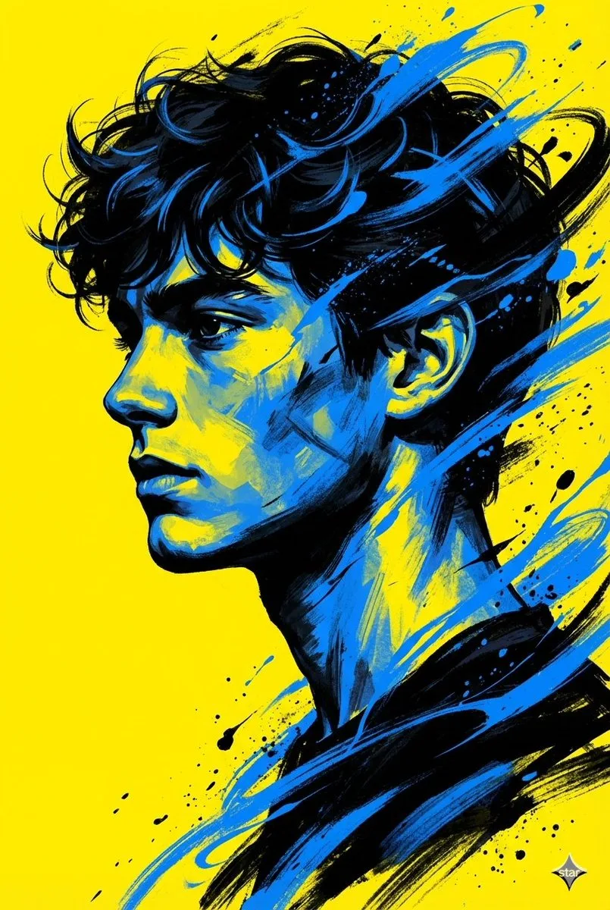

# Harboriis — by @harboriis

[← Back to Community Examples](../../EXAMPLES.md) · Category: Photography · Model: `Nano Banana`

<a href="https://x.com/harboriis/status/2020862767574728935"></a>

Source: **[@harboriis on X](https://x.com/harboriis/status/2020862767574728935)** · Creator: [Harboriis](https://x.com/harboriis)

## Prompt

```text
A bold, high contrast digital portrait of a young man in side profile, facing left. The style is expressive and painterly, with dynamic brush strokes and paint splashes flowing from the head and shoulders, creating a sense of motion and energy. Strong black shadows define the face, with sharp highlights for depth and drama. The background is a solid vibrant yellow, minimal and striking. Accents of deep blue and black paint strokes wrap around the subject, giving a modern street art and sports poster feel. Cinematic lighting, high detail, gritty texture, confident and focused expression, contemporary illustration style, ultra sharp, poster quality.
```

## Try it

Paste the prompt into **[vinano.ai](https://vinano.ai?utm_source=github&utm_medium=readme&utm_campaign=awesome-image-video-prompts-updating&utm_content=x-page-try)** to generate your own version.

> The image and prompt belong to @harboriis ([original post](https://x.com/harboriis/status/2020862767574728935)) and are shown here with credit for reference. Creators can ask for changes or removal by opening an issue.
