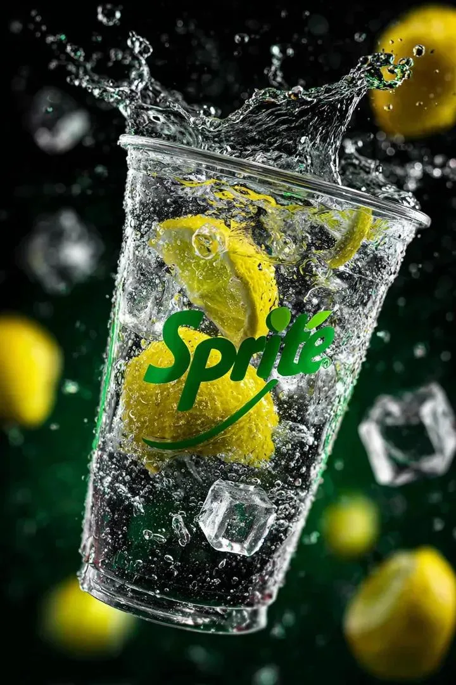

# 𝐌 — by @Strength04_X

[← Back to Community Examples](../../EXAMPLES.md) · Category: Food & Drink · Model: `Nano Banana`

<a href="https://x.com/Strength04_X/status/2029237065783873715"></a>

Source: **[@Strength04_X on X](https://x.com/Strength04_X/status/2029237065783873715)** · Creator: [𝐌](https://x.com/Strength04_X)

## Prompt

```text
A transparent cup filled with fresh Sprite lemon soda floating in the air, surrounded by sparkling lemon-lime soda splashes, bright ice cubes, and tiny carbonation bubbles bursting around the drink. The cup features green minimal text design, giving a fresh and clean brand look. Hyper-realistic beverage product photography with professional studio lighting, crisp texture details, macro clarity as if shot with Sony A7s. Black and neon green background highlighting freshness --stylize 250
```

## Try it

Paste the prompt into **[vinano.ai](https://vinano.ai?utm_source=github&utm_medium=readme&utm_campaign=awesome-image-video-prompts-updating&utm_content=x-page-try)** to generate your own version.

> The image and prompt belong to @Strength04_X ([original post](https://x.com/Strength04_X/status/2029237065783873715)) and are shown here with credit for reference. Creators can ask for changes or removal by opening an issue.
