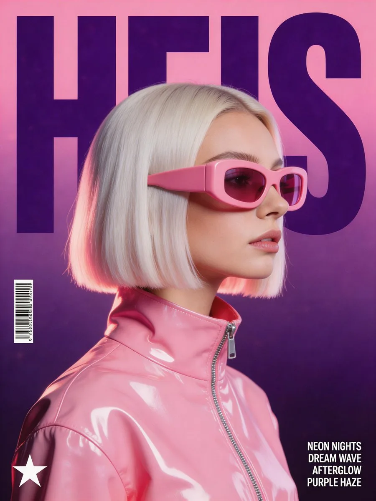

# Heisenberg — by @rovvmut_

[← Back to Examples from X](../../EXAMPLES.md) · Category: Poster Design · Model: `Nano Banana`

<a href="https://x.com/rovvmut_/status/2026574551207792783"></a>

Original post: **[@rovvmut_ on X](https://x.com/rovvmut_/status/2026574551207792783)** · Creator: [Heisenberg](https://x.com/rovvmut_)

## Prompt

```text
A stylized, retro-futuristic music poster in a synthwave aesthetic. The central focus is a woman in profile with a platinum blonde bob haircut, wearing oversized, chunky pink opaque visor sunglasses and a high-collar, extremely glossy pink vinyl jacket with visible zipper detail. Behind her, the word "HEIS" is written in massive, dark purple, condensed block typography, partially hidden by her head. The background is a clean gradient shifting from soft magenta to deep purple, overlaid with a subtle film grain texture. Lighting: Soft studio lighting with high-specular highlights on the glossy jacket and rim lighting on the hair. Color Palette: Dominant shades of bubblegum pink, deep violet, and lavender. Graphics: A small barcode on the left, a minimalist star logo in the bottom-left corner, and four lines of small sans-serif song lyrics in the bottom-right corner. Atmosphere: High-fashion, electronic dance music vibe, clean and polished composition.
```

## Try it

Paste the prompt into **[vinano.ai](https://vinano.ai?utm_source=github&utm_medium=readme&utm_campaign=awesome-image-video-prompts-updating&utm_content=x-page-try)** to generate your own version.

> The image and prompt belong to [@rovvmut_](https://x.com/rovvmut_) and are shown here with credit for reference. Creators can ask for changes or removal by opening an issue.
