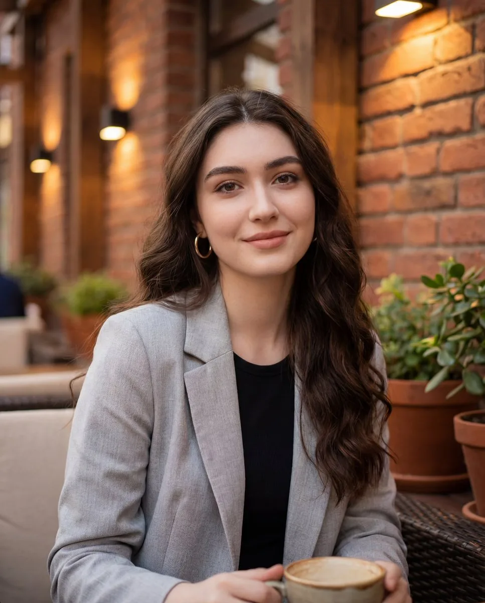

# Zara — by @ZaraIrahh

[← Back to Examples from X](../../EXAMPLES.md) · Category: Photography · Model: `Nano Banana`

<a href="https://x.com/ZaraIrahh/status/2017407873836614094"></a>

Original post: **[@ZaraIrahh on X](https://x.com/ZaraIrahh/status/2017407873836614094)** · Creator: [Zara](https://x.com/ZaraIrahh)

## Prompt

```text
{ "image_type": "photograph", "genre": "casual lifestyle portrait", "orientation": "portrait", "composition": { "framing": "medium close-up", "camera_angle": "eye-level", "subject_position": "centered with slight right bias", "crop": "head and upper torso visible", "depth_of_field": "shallow, softly blurred background", "perspective": "natural human-eye perspective" }, "subject": { "count": 1, "gender_presentation": "female-presenting", "age_range": "young adult", "pose": "seated, relaxed posture", "expression": "soft smile, calm and approachable", "gaze": "directly at camera", "skin_tone": "light to medium warm complexion", "facial_features": { "face_shape": "oval", "eyes": "large, dark-colored", "eyebrows": "full, well-defined", "lips": "medium-full with subtle gloss", "makeup": "natural glam; defined eyelashes, eyeliner, even complexion, soft blush, neutral lip color" }, "hair": { "color": "dark brown", "length": "long", "texture": "wavy", "part": "slightly off-center", "styling": "loose, natural waves" }, "accessories": [ "medium-sized gold hoop earrings" ], "clothing": { "outerwear": "light gray coat or blazer", "innerwear": "black top", "style": "casual-chic" } }, "environment": { "setting": "outdoor café or courtyard", "background_elements": [ "brick wall", "wooden beams", "warm wall-mounted lights", "potted green plants", "outdoor seating" ], "location_type": "urban, cozy, semi-enclosed outdoor space", "time_of_day": "late afternoon or early evening" }, "lighting": { "type": "natural ambient with warm artificial accents", "direction": "front and slightly above", "quality": "soft, diffused", "shadows": "minimal, gentle facial contouring", "color_temperature": "warm-neutral" }, "color_palette": { "dominant_colors": [ "warm browns", "brick red", "gray", "black", "natural green" ], "overall_tone": "warm and inviting", "contrast": "moderate" }, "technical_details": { "camera_style": "smartphone or mirrorless camera", "lens_effect": "background blur resembling wide aperture", "sharpness": "high on subject, soft background", "noise": "minimal", "resolution": "high" }, "artistic_style": { "mood": "intimate, relaxed, friendly", "aesthetic": "modern lifestyle photography", "post_processing": "light color correction, subtle skin smoothing, enhanced warmth" }, "props": [ "cup held near bottom frame (partially visible)" ], "background_blur": { "type": "bokeh", "intensity": "medium" } }
```

## Try it

Paste the prompt into **[vinano.ai](https://vinano.ai?utm_source=github&utm_medium=readme&utm_campaign=awesome-image-video-prompts-updating&utm_content=x-page-try)** to generate your own version.

> The image and prompt belong to [@ZaraIrahh](https://x.com/ZaraIrahh) and are shown here with credit for reference. Creators can ask for changes or removal by opening an issue.
