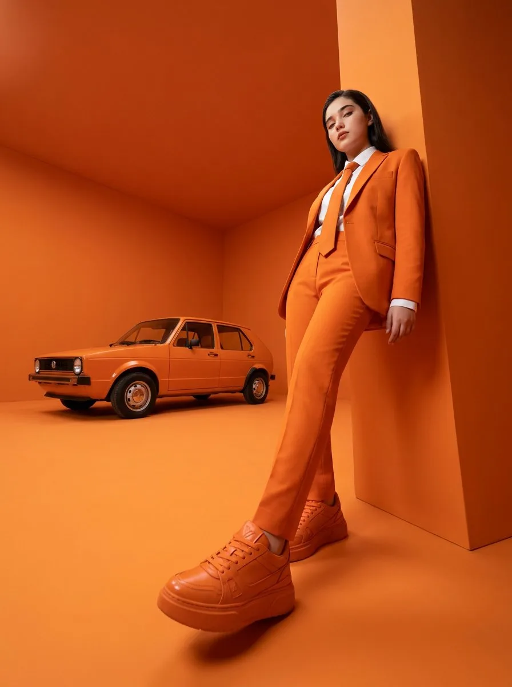

# Hania Ai — by @HaniaAi12

[← Back to Examples from X](../../EXAMPLES.md) · Category: Photography · Model: `Nano Banana`

<a href="https://x.com/HaniaAi12/status/2036605650353180709"></a>

Original post: **[@HaniaAi12 on X](https://x.com/HaniaAi12/status/2036605650353180709)** · Creator: [Hania Ai](https://x.com/HaniaAi12)

## Prompt

```text
High-fashion editorial photography of a woman with the uploaded face as reference, leaning casually against a geometric orange wall with her right leg extended forward. She wears a tailored bright orange suit, matching tie, crisp white shirt, and chunky orange sneakers. Her styling is sleek and confident, with a modern, polished look. The environment is a surreal, minimalist room with seamless orange surfaces, featuring a vintage orange hatchback parked mid-ground left. Captured from a low-angle using a 24mm wide-angle lens for strong forced perspective, emphasizing the foreground sneaker with a deep depth of field. Soft, diffused studio lighting casts clean shadows, enhancing the vibrant, highly saturated monochromatic orange palette with sharp white accents, contrasting matte suit fabrics against smooth leather shoes and the glossy finish of the car.
```

## Try it

Paste the prompt into **[vinano.ai](https://vinano.ai?utm_source=github&utm_medium=readme&utm_campaign=awesome-image-video-prompts-updating&utm_content=x-page-try)** to generate your own version.

> The image and prompt belong to [@HaniaAi12](https://x.com/HaniaAi12) and are shown here with credit for reference. Creators can ask for changes or removal by opening an issue.
