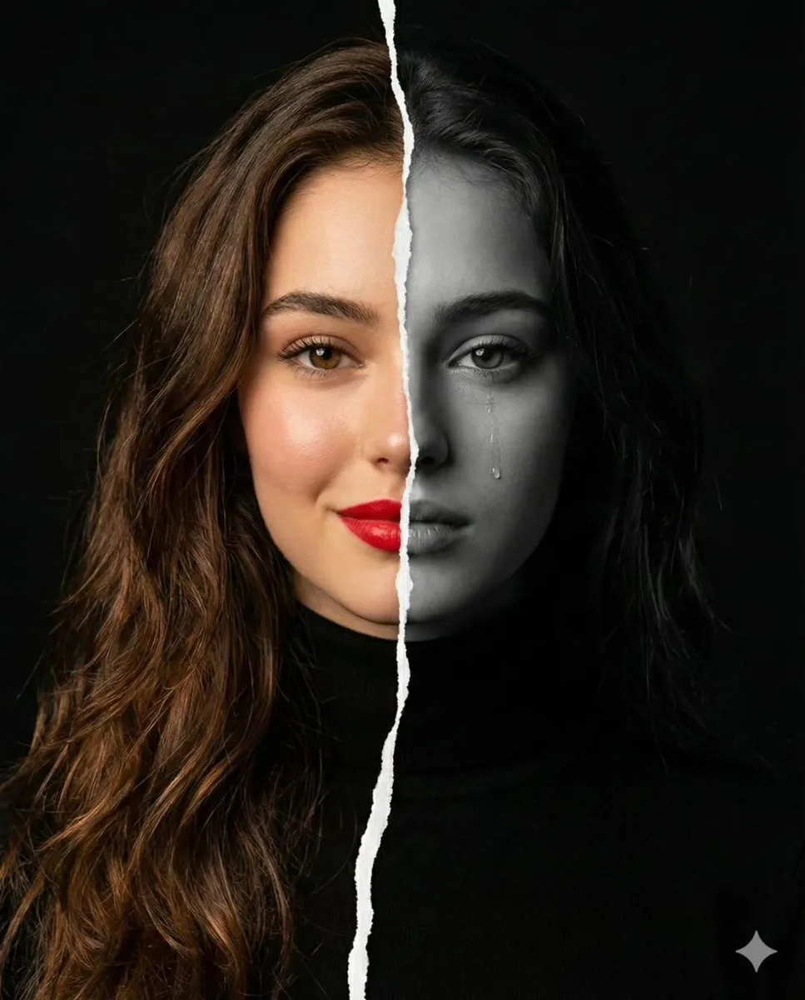

# Aijaz — by @iamsofiaijaz

[← Back to Examples from X](../../EXAMPLES.md) · Category: Photography · Model: `Nano Banana`

<a href="https://x.com/iamsofiaijaz/status/2017930809899192642"></a>

Original post: **[@iamsofiaijaz on X](https://x.com/iamsofiaijaz/status/2017930809899192642)** · Creator: [Aijaz](https://x.com/iamsofiaijaz)

## Prompt

```text
​A high-resolution conceptual portrait of a woman’s face vertically split down the middle by a jagged, torn paper edge. The left side is in vibrant color, featuring a warm smile, glowing skin, and bold red lipstick. The right side is in dramatic black and white, showing a somber expression with a single tear rolling down her cheek. Dark, moody background, cinematic lighting, sharp focus on the eyes, hyper-realistic textures.
```

## Try it

Paste the prompt into **[vinano.ai](https://vinano.ai?utm_source=github&utm_medium=readme&utm_campaign=awesome-image-video-prompts-updating&utm_content=x-page-try)** to generate your own version.

> The image and prompt belong to [@iamsofiaijaz](https://x.com/iamsofiaijaz) and are shown here with credit for reference. Creators can ask for changes or removal by opening an issue.
