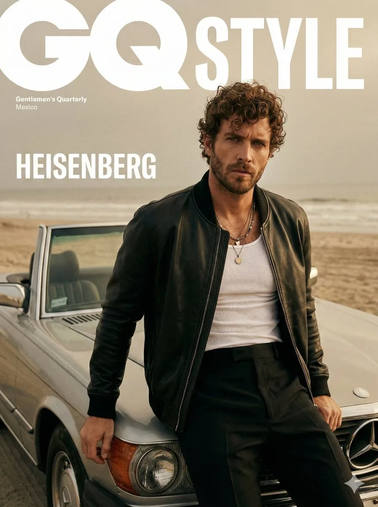

# Heisenberg — by @rovvmut_

[← Back to Community Examples](../../EXAMPLES.md) · Category: Photography · Model: `Nano Banana`

<a href="https://x.com/rovvmut_/status/2025093067787960824"></a>

Source: **[@rovvmut_ on X](https://x.com/rovvmut_/status/2025093067787960824)** · Creator: [Heisenberg](https://x.com/rovvmut_)

## Prompt

```text
A cinematic fashion editorial portrait of male model for a GQ Style magazine cover. He is leaning against the hood of a vintage 1960s silver convertible on a hazy, overcast beach.

Subject & Pose: A male model with a well-groomed dark beard and messy, curly dark hair. He is looking directly at the camera with an intense, neutral expression. He is wearing a heavy, oversized black leather bomber jacket with large utility pockets, worn open over a white ribbed tank top and high-waisted black trousers with double-buckle belt detailing. Two thin gold necklaces with small pendants hang mid-chest.

Setting & Composition: Outdoor beach setting with a very shallow depth of field. The background shows a desaturated, sandy shore and a pale, misty sky with a soft horizon line. The car is a polished metallic silver, reflecting the flat light of the sky. The camera angle is at eye-level, framing the subject from the waist up.

Lighting & Color: Soft, diffused daylight with a moody, cinematic color grade. The palette is dominated by muted earth tones, blacks, and silvers. High-end film grain is visible throughout.

Typography (Overlay): Large, bold white "GQ Style" logo across the top in a classic serif font. Smaller white sans-serif text on the mid-left reads "HEISENBERG"
```

## Try it

Paste the prompt into **[vinano.ai](https://vinano.ai?utm_source=github&utm_medium=readme&utm_campaign=awesome-image-video-prompts-updating&utm_content=x-page-try)** to generate your own version.

> The image and prompt belong to @rovvmut_ ([original post](https://x.com/rovvmut_/status/2025093067787960824)) and are shown here with credit for reference. Creators can ask for changes or removal by opening an issue.
