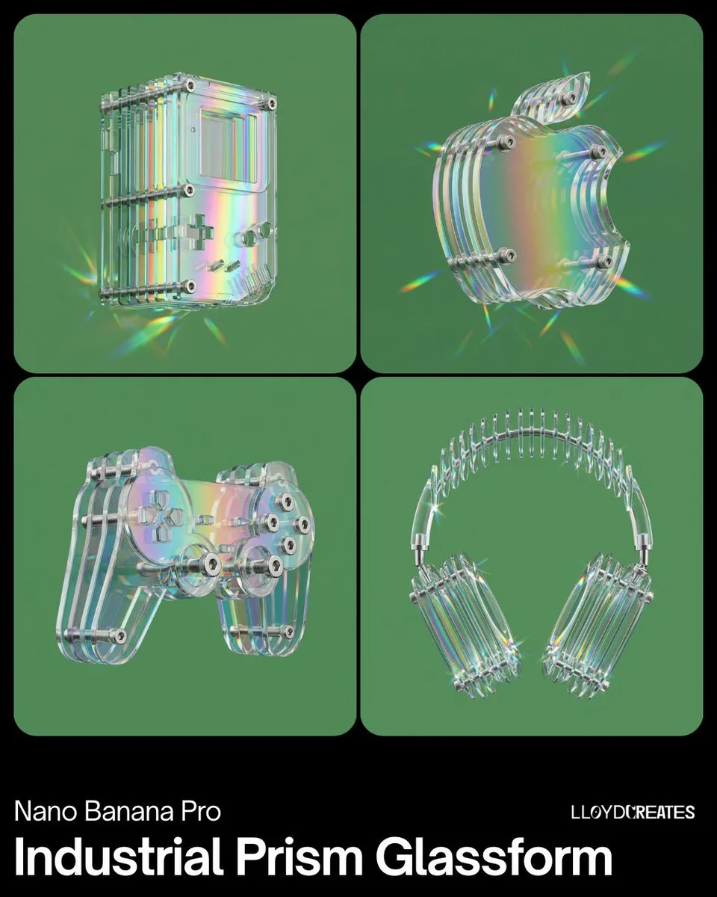

# Lloyd Creates — by @lloydcreates

[← Back to Examples from X](../../EXAMPLES.md) · Category: Illustration & 3D · Model: `Nano Banana`

<a href="https://x.com/lloydcreates/status/2020332873736196341"></a>

Original post: **[@lloydcreates on X](https://x.com/lloydcreates/status/2020332873736196341)** · Creator: [Lloyd Creates](https://x.com/lloydcreates)

## Prompt

```text
{
  "request": {
    "product": "[PRODUCT HERE]",
    "background_color": "#59925C",
    "style": "prismatic_industrial_minimalism",
    "visual_elements": {
      "structure": "multiple separate vertical acrylic layers forming the product silhouette — each layer is a distinct flat panel with visible air gaps between them, like slices of the product spaced apart",
      "material": "high-clarity glass with rainbow prismatic iridescent tint",
      "hardware": "stainless steel through-bolts with visible internal Allen hexagonal socket heads — bolts pass through all layers front to back, holding them together with visible spacing",
      "orientation": "strictly upright vertical placement, full object visibility",
      "lighting": "dispersive spectral highlights and sharp caustics"
    },
    "composition": {
      "frame": "wide shot, no cropping, centered full-product view",
      "camera_angle": "eye-level studio perspective, slightly angled to reveal gaps between layers",
      "depth_of_field": "deep enough to maintain focus on hardware details",
      "background": "seamless solid #59925C background with no floor, surface, pedestal, platform, table, shadow ground, or horizon line — the product floats against a uniform single-color field",
      "grounding": "no visible ground plane, no reflective surface beneath the product"
    },
    "rendering_details": {
      "transparency": "multi-layered refraction with thin-film interference",
      "finish": "polished edges with subtle holographic light dispersion",
      "hardware_detail": "macro-precision on hex-head bolt sockets",
      "layer_direction": "every glass/acrylic layer is strictly vertical — no horizontal slabs, curved shells, or molded forms",
      "layer_separation": "each glass panel must be visibly separated with clear air gaps — not fused or touching — bolts are the only element connecting the layers"
    }
  }
}
```

## Try it

Paste the prompt into **[vinano.ai](https://vinano.ai?utm_source=github&utm_medium=readme&utm_campaign=awesome-image-video-prompts-updating&utm_content=x-page-try)** to generate your own version.

> The image and prompt belong to [@lloydcreates](https://x.com/lloydcreates) and are shown here with credit for reference. Creators can ask for changes or removal by opening an issue.
