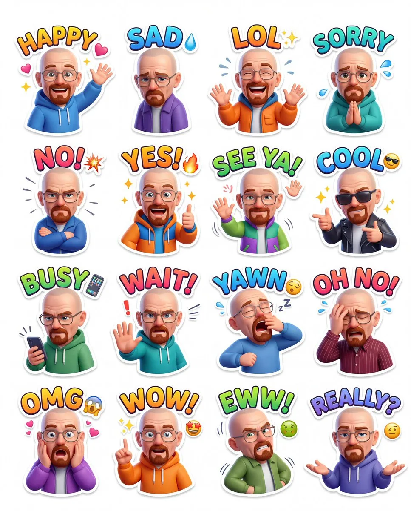

# WasifAI — by @doctorwasif

[← Back to Examples from X](../../EXAMPLES.md) · Category: Illustration & 3D · Model: `Nano Banana`

<a href="https://x.com/doctorwasif/status/2039709119150702727"></a>

Original post: **[@doctorwasif on X](https://x.com/doctorwasif/status/2039709119150702727)** · Creator: [WasifAI](https://x.com/doctorwasif)

## Prompt

```text
{
  "task": "premium_animated_sticker_pack",
  "ref_image": "use_only_uploaded_identity_preserve_all_features",
  "format": { "grid": "4x4", "count": 16, "aspect": "2:3", "spacing": "clean", "alignment": "perfect", "bg": "white" },
  "style": {
    "character": "chibi_65_70_head_dynamic_pose_rounded_expressive",
    "render": "high_end_3D_pixar_quality",
    "outline": "white_stroke"
  },
  "clothing": {
    "type": "modern_streetwear",
    "items": ["hoodies","jackets"],
    "colors": ["blue","purple","orange","teal"],
    "variation": "slight_consistent"
  },
  "text": {
    "placement": "top",
    "style": "bold_curved_gradient",
    "effects": ["white_outline","shadow","emoji"]
  },
  "stickers": [
    ["HAPPY","wave"], ["SAD","down"], ["LOL","laugh"], ["SORRY","hands_together"],
    ["NO!","cross_arms"], ["YES!","thumbs_up"], ["SEE YA!","bye"], ["COOL","finger_guns"],
    ["BUSY","phone"], ["WAIT!","stop"], ["YAWN","sleepy"], ["OH NO!","facepalm"],
    ["OMG","shock"], ["WOW!","point"], ["EWW!","disgust"], ["REALLY?","shrug"]
  ],
  "lighting": "soft_studio_rim_light_bright_clean",
  "extras": ["sparkles","hearts","sweat","motion_lines"],
  "consistency": "same_identity_face_glasses_grooming_quality_proportions",
  "negative": "no_mismatch_no_identity_change_no_realistic_body_no_stiff_no_dull_no_overlap_no_bad_hands_no_blur_no_low_quality_no_inconsistent_no_watermark"
}
```

## Try it

Paste the prompt into **[vinano.ai](https://vinano.ai?utm_source=github&utm_medium=readme&utm_campaign=awesome-image-video-prompts-updating&utm_content=x-page-try)** to generate your own version.

> The image and prompt belong to [@doctorwasif](https://x.com/doctorwasif) and are shown here with credit for reference. Creators can ask for changes or removal by opening an issue.
