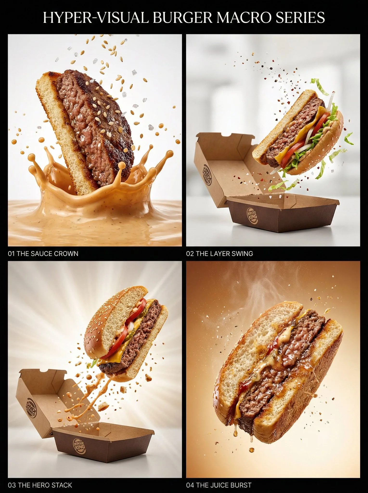

# ANKIT PATEL 🇮🇳 | AI — by @Ankit_patel211

[← Back to Community Examples](../../EXAMPLES.md) · Category: Food & Drink · Model: `Nano Banana`

<a href="https://x.com/Ankit_patel211/status/2009339340418371647"></a>

Source: **[@Ankit_patel211 on X](https://x.com/Ankit_patel211/status/2009339340418371647)** · Creator: [ANKIT PATEL 🇮🇳 | AI](https://x.com/Ankit_patel211)

## Prompt

```text
{
  "project": {
    "title": "Hyper-Visual Burger Macro Series",
    "version": "2.0_Structured_High_Speed",
    "target_aesthetic": "High-end Commercial Advertising"
  },
  "technical_foundation": {
    "camera_hardware": {
      "body": "Nikon D850",
      "lens": "105mm f/2.8 Micro-Nikkor",
      "settings": "High-speed shutter, deep depth of field, ISO 100"
    },
    "global_image_specs": {
      "aspect_ratio": "2:3",
      "resolution": "8K Ultra-HD",
      "lighting_style": "Studio high-key with rim-light accents",
      "color_profile": "Vibrant, high-saturation golden browns, reds, and greens"
    }
  },
  "scene_manifest": [
    {
      "scene_id": "01_THE_SAUCE_CROWN",
      "composition": {
        "focus": "Macro interaction",
        "subject": "Juicy burger slice (beef patty cross-section with bun edge)",
        "action": "Vertical plunge into glossy burger sauce"
      },
      "physics_elements": {
        "liquid": "Thick, creamy signature burger sauce",
        "splash_shape": "Symmetrical dynamic crown",
        "particles": "Suspended sauce droplets, sesame seeds, and salt flakes"
      },
      "texture_details": [
        "Seared beef fibers",
        "Juicy meat sheen",
        "Toasted bun crumb texture"
      ]
    },
    {
      "scene_id": "02_THE_LAYER_SWING",
      "composition": {
        "focus": "Dynamic movement",
        "subject": "Burger slice in motion",
        "environment": "Open burger box context"
      },
      "physics_elements": {
        "motion": "Angular swing trajectory",
        "particles": "Pepper flakes, salt crystals, and lettuce shreds",
        "background": "Soft-focus bright studio"
      },
      "lighting": "Balanced shadow/highlight contrast for rich 3D depth"
    },
    {
      "scene_id": "03_THE_HERO_STACK",
      "composition": {
        "focus": "Action-packed layout",
        "subject": "Upward ejecting burger slice",
        "branding": "Open branded burger box beneath"
      },
      "lighting_effects": {
        "primary": "Radial spotlight burst behind subject",
        "secondary": "Fill light emphasizing juicy meat and bun texture"
      },
      "particle_vfx": "Explosive trail of sauce droplets, crumbs, and sesame seeds"
    },
    {
      "scene_id": "04_THE_JUICE_BURST",
      "composition": {
        "focus": "Extreme macro freeze-frame",
        "subject": "Burger slice juice release",
        "action": "Mid-air compression and release of meat juices"
      },
      "environment_vfx": {
        "background": "Warm amber-to-cream high-contrast gradient",
        "atmosphere": "Fine mist of steam and seasoning particles",
        "shimmer": "Backlit glints on melted fat, sauce, and bun surface"
      }
    }
  ],
  "negative_parameters": [
    "motion blur",
    "plastic or artificial food textures",
    "low-resolution noise",
    "muddy colors",
    "overexposed highlights",
    "unrealistic food physics"
  ]
}
```

## Try it

Paste the prompt into **[vinano.ai](https://vinano.ai?utm_source=github&utm_medium=readme&utm_campaign=awesome-image-video-prompts-updating&utm_content=x-page-try)** to generate your own version.

> The image and prompt belong to @Ankit_patel211 ([original post](https://x.com/Ankit_patel211/status/2009339340418371647)) and are shown here with credit for reference. Creators can ask for changes or removal by opening an issue.
